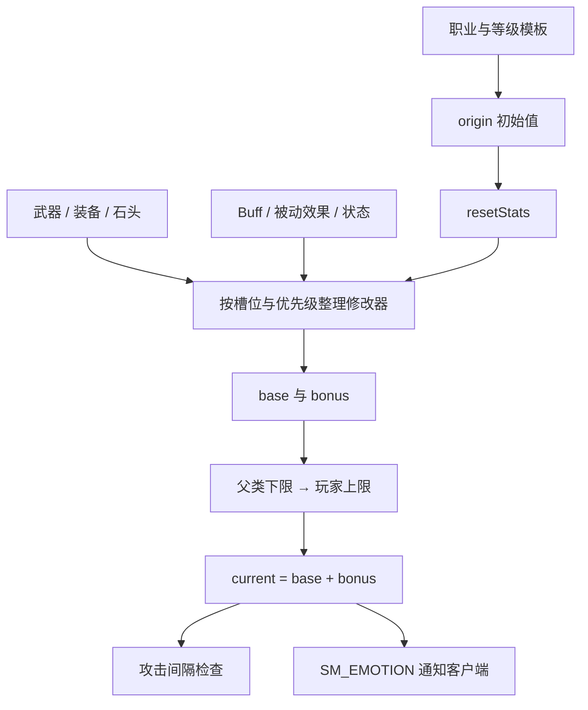

# 攻击速度与移动速度实现

这份笔记解释下载服务端的真实函数和属性语义，帮助后续与同版本客户端对照。它不把 Java 类的字段当成 C++ 对象偏移；目前没有证据确定客户端的速度函数地址、对象基址或字段偏移。

## 先理解单位

| 属性 | 服务端表示 | 值变大意味着什么 |
|---|---|---|
| `ATTACK_SPEED` | 两次普通攻击之间的间隔，检查时直接作为毫秒 | 攻击更慢，例如 2000 表示间隔约 2 秒 |
| `SPEED` | 速度的千分整数表示；回包时除以 `1000f` | 移动更快，例如 6000 在相应回包中变成 6.0 |
| `FLY_SPEED` | 同样以千分整数保存 | 飞行更快 |
| `BOOST_CASTING_TIME` 等 | 技能施法时间的修正量 | 需要按技能公式解释，不能与普通攻击间隔混用 |

最容易弄反的是攻击速度：装备描述“攻击速度提升 20%”在这套计算里通常意味着对间隔施加负向百分比，而不是把毫秒数加大。

## 关键入口

| 任务 | 文件/函数 | 应观察的值 |
|---|---|---|
| 属性定义 | [StatEnum.java](https://github.com/ZON3DEV/AionLightning/blob/94fc8048e5fc198f000c0ca2176c65034c57cb39/gameserver/src/org/openaion/gameserver/model/gameobjects/stats/StatEnum.java) | `ATTACK_SPEED/SPEED/FLY_SPEED` |
| 属性存储 | [Stat.getCurrent:89](https://github.com/ZON3DEV/AionLightning/blob/94fc8048e5fc198f000c0ca2176c65034c57cb39/gameserver/src/org/openaion/gameserver/model/gameobjects/stats/Stat.java#L89) | 当前值等于 `base + bonus`，`origin` 用于重置 |
| 初始属性 | [PlayerGameStats.initStats](https://github.com/ZON3DEV/AionLightning/blob/94fc8048e5fc198f000c0ca2176c65034c57cb39/gameserver/src/org/openaion/gameserver/model/gameobjects/stats/PlayerGameStats.java) | 从职业/等级模板取得速度，乘 1000 并取整 |
| 装备/Buff 后重算 | [PlayerGameStats.recomputeStats](https://github.com/ZON3DEV/AionLightning/blob/94fc8048e5fc198f000c0ca2176c65034c57cb39/gameserver/src/org/openaion/gameserver/model/gameobjects/stats/PlayerGameStats.java) | 按效果、装备槽和修改器优先级重建 base/bonus |
| 百分比修改 | [RateModifier.apply](https://github.com/ZON3DEV/AionLightning/blob/94fc8048e5fc198f000c0ca2176c65034c57cb39/gameserver/src/org/openaion/gameserver/model/gameobjects/stats/modifiers/RateModifier.java) | 是修改基础值，还是计算附加值 |
| 基础下限 | [CreatureGameStats.applyLimits:245](https://github.com/ZON3DEV/AionLightning/blob/94fc8048e5fc198f000c0ca2176c65034c57cb39/gameserver/src/org/openaion/gameserver/model/gameobjects/stats/CreatureGameStats.java#L245) | 三类速度的最小整数值都设为 600 |
| 玩家上限 | [PlayerGameStats.applyLimits:283](https://github.com/ZON3DEV/AionLightning/blob/94fc8048e5fc198f000c0ca2176c65034c57cb39/gameserver/src/org/openaion/gameserver/model/gameobjects/stats/PlayerGameStats.java#L283) | 移动 12000、飞行 16000、攻击间隔最多减基础值的 50% |
| 普攻包入口 | [CM_ATTACK.readImpl:56](https://github.com/ZON3DEV/AionLightning/blob/94fc8048e5fc198f000c0ca2176c65034c57cb39/gameserver/src/org/openaion/gameserver/network/aion/clientpackets/CM_ATTACK.java#L56) | 目标 ID、动作序号、动作时间、攻击类型 |
| 请求间隔检查 | [PlayerController.checkAttackPacketSpeed:854](https://github.com/ZON3DEV/AionLightning/blob/94fc8048e5fc198f000c0ca2176c65034c57cb39/gameserver/src/org/openaion/gameserver/controllers/PlayerController.java#L854) | 当前间隔、上次收到攻击时间、本次时间 |
| 攻击执行 | [CreatureController.attackTarget:281](https://github.com/ZON3DEV/AionLightning/blob/94fc8048e5fc198f000c0ca2176c65034c57cb39/gameserver/src/org/openaion/gameserver/controllers/CreatureController.java#L281) | 另一处时间检查、目标限制、伤害计算与延迟落地 |
| 玩家移动入口 | [CM_MOVE.readImpl:71](https://github.com/ZON3DEV/AionLightning/blob/94fc8048e5fc198f000c0ca2176c65034c57cb39/gameserver/src/org/openaion/gameserver/network/aion/clientpackets/CM_MOVE.java#L71) / `runImpl` | 客户端上报的坐标、朝向、移动类型与目标坐标 |
| 坐标/区域更新 | [World.updatePosition:122](https://github.com/ZON3DEV/AionLightning/blob/94fc8048e5fc198f000c0ca2176c65034c57cb39/gameserver/src/org/openaion/gameserver/world/World.java#L122) | 位置、旧区域、新区域、KnownList 更新 |
| NPC 定时移动 | [MoveController.schedule](https://github.com/ZON3DEV/AionLightning/blob/94fc8048e5fc198f000c0ca2176c65034c57cb39/gameserver/src/org/openaion/gameserver/controllers/MoveController.java) / `move` | 每秒移动任务、目标方向、步长与地形高度 |
| 速度同步到客户端 | [SM_EMOTION:285](https://github.com/ZON3DEV/AionLightning/blob/94fc8048e5fc198f000c0ca2176c65034c57cb39/gameserver/src/org/openaion/gameserver/network/aion/serverpackets/SM_EMOTION.java#L285) 的 `START_EMOTE2` 分支 | 状态、浮点移动速度、基础/当前攻击间隔 |

## 属性是怎样算出来的



`CreatureGameStats.addModifiers/removeModifiers` 会触发重算。重算会先恢复初始属性，然后重新应用仍存在的效果；因此临时直接写某个 current 值，可能在下一次换装、效果变化或恢复角色时被覆盖。

`RateModifier.apply(baseStat, currentStat)` 的附加值分支计算：

```text
bonusContribution = round(percentage × baseStat / 100)
```

修改基础值的分支则计算 `round(baseStat × (1 + percentage/100))`。`Add/Set/Rate/Mean` 等修改器含义不同，且存在优先级，不能把装备里的所有数字无条件相加。

双持还有专门逻辑：主副手基础攻击间隔不同方式合并，副手按 25% 参与；两把武器的攻击速度附加值只取其中更有利的一个，避免重复叠加。具体应读 `PlayerGameStats` 约 165–229 行，不要套用“左右手速度提升相加”的直觉。

下限与上限也分两层：先调用父类 `applyLimits`，再应用玩家特有的移动/飞行上限和 50% 攻击间隔减少限制。这些是此提交的实现常量，不表示已核验的官方各版本规则。

## 一次普通攻击为何能被拒绝

核心检查等价于：

```java
int intervalMs = owner.getGameStats().getCurrentStat(StatEnum.ATTACK_SPEED);
long now = System.currentTimeMillis();
if (now - lastAttackMilis < intervalMs) {
    return false;
}
lastAttackMilis = now;
return true;
```

这是服务器接收时间与服务端最终属性的比较。客户端播放动画、显示数值和服务器是否接受下一次攻击分属不同环节。

`PlayerController` 和其父类 `CreatureController` 各自声明了私有 `lastAttackMilis`，并在各自检查中使用，二者是不同字段。`CM_ATTACK` 先做包间隔检查，攻击控制器之后再做攻击条件检查；不能误读为同一个时间戳被立即检查两遍。

该实现使用墙上时钟 `System.currentTimeMillis()`；网络延迟、计时误差和系统时钟变化会影响观测。为了学习，记录请求被拒绝的具体条件，比只观察屏幕动画更可靠。

## 玩家移动与 NPC 移动为什么不同

玩家的 `CM_MOVE` 按类型读取当前位置、朝向和可选目标位置，然后更新世界位置、触发移动/飞行状态和 `SM_MOVE` 广播。在已经阅读的普通移动分支和 `World.updatePosition` 中，没有看到完整的“位移距离 ≤ 速度 × 时间”校验。因此只能说该路径负责位置接收与同步，不能仅凭存在 `SPEED` 属性就认定所有移动都由服务端严格积分和限速。

NPC 的 `MoveController` 则可每秒执行 `move()`，读取目标距离并沿方向推进，结合 `GeoEngine` 修正地形高度。`schedule()` 里出现 `getCurrentStat(SPEED) / 1000` 的整数除法，和回包 `/1000f` 的浮点除法不同，阅读精度问题时应注意。

客户端平滑显示移动、服务端附近广播、NPC 位置推进、人物属性计算是四个不同职责。找“移动速度函数”时应先明确想研究哪一层。

## 速度怎样回到客户端

`PlayerGameStats.recomputeStats` 比较新旧跑速、飞行速度和攻击间隔；变化时广播 `SM_EMOTION(...START_EMOTE2...)`。相应写包顺序是：

```text
对象 ID: writeD
情绪类型: writeC
状态: writeH
移动速度: writeF，使用 SPEED 或 FLY_SPEED / 1000f
基础攻击间隔: writeH
当前攻击间隔: writeH
```

这些是 **SM_EMOTION 特定分支的负载字段**；不是 C++ 内存布局，也不是所有情绪类型都有这些字段。连接层的长度、操作码和加密包头还在其他位置处理。

`SM_STATS_INFO` 同时用于更新其它面板属性，不应凭类名推断速度字段就在其中。要确认某个数值怎样同步，必须追踪实际 `writeImpl`。

## 从源码学习到联调的三个实验

| 实验 | 先在纸上计算 | 未来联调应记录 |
|---|---|---|
| 基础攻击间隔 2000，附加 RateModifier 为 −20% | bonus = −400，current = 1600 ms | 重算前后属性、请求间隔和服务端接受/拒绝结果 |
| 基础移动整数 6000，附加 +20% | bonus = 1200，current = 7200，回包为 7.2 | 换装/Buff、SM_EMOTION 对应字段、实际坐标变化 |
| 移动总值超过 12000，或攻击加速超过 50% | 对照 `applyLimits` 判断实际截断 | 截断前后 base/bonus/current，效果到期后是否恢复 |

这些是源码公式的演算示例，尚未在目标客户端运行。拿到匹配客户端和完成编译后，先做普通换装/Buff 对照实验：在 Java 调试器中给上述函数设断点，记录重算和回包；再分析客户端处理相同字段的代码。这样可以逐步建立“服务端语义 → 协议字段 → 客户端存储/显示”的证据链。

服务端函数名只能提供语义线索。客户端最终地址和偏移仍需匹配二进制版本、模块基址、结构布局及反汇编/运行证据；目前不填写猜测值。
