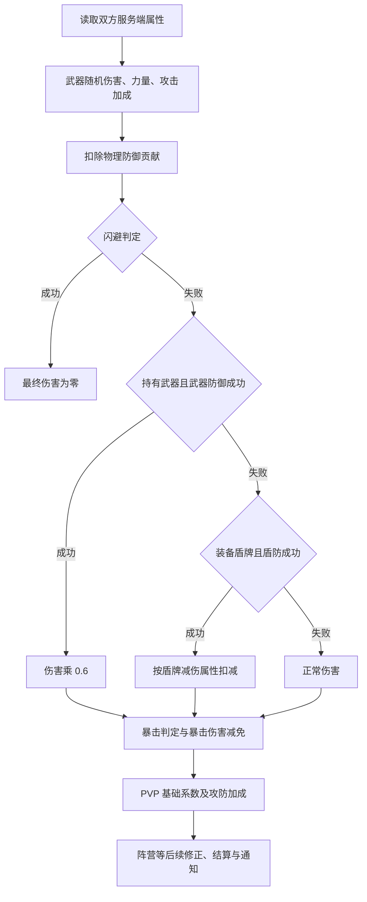

# 暴击、盾防与剑星 PVP：从源码到操作理解

核对日期：2026-10-10。依据本机已校验的 AionLightning `1.9.0` 分支提交 `94fc8048e5fc198f000c0ca2176c65034c57cb39`。**以下是这份模拟器的实现，不是已经验证的官方 1.9 战斗规则。** 源码混有 1.9/2.1 路径，默认版本为 2.1.0.12；完整客户端、编译和对战运行尚未完成。

本次新增：以你的**塔哈巴塔枪、未加临时增益的暴击 598**为入口，展开后台伤害计算、精锐千夫＋15基线、属性收益阈值、两把合成枪与八职业对战的条件分析。先读第 10–14 节看数值，再读第 15–18 节看武器、职业和验证方法。598 按“装备后、料理和卷轴等临时增益前”理解；若它是其他状态，代入实际战斗面板重新计算。

## 1. 一次攻击究竟经历什么

普通物理攻击的主要链路：



图简化了额外攻击次数、双持、副手、观察器伤害倍率等分支。源码也会计算 `CRITICAL_DODGE` 状态，但闪避伤害最终仍为零。

物理技能路径不同：`DamageEffect.calculate` 先准备伤害、武器防御/盾防和暴击结果，再调用 `EffectTemplate.calculate` 做效果是否成功的检查，其中包括物理闪避或魔法抵抗。因此只看 `calculateSkillPhysicalStatus` 没有闪避，就断言“物理技能无法闪避”，会漏掉另一个阶段。还要检查具体效果的 `noresist`、前置效果和异常状态条件。

入口：[AttackUtil.java:56](https://github.com/ZON3DEV/AionLightning/blob/94fc8048e5fc198f000c0ca2176c65034c57cb39/gameserver/src/org/openaion/gameserver/controllers/attack/AttackUtil.java#L56)、[DamageEffect.java:60](https://github.com/ZON3DEV/AionLightning/blob/94fc8048e5fc198f000c0ca2176c65034c57cb39/gameserver/src/org/openaion/gameserver/skill/effect/DamageEffect.java#L60)、[EffectTemplate.java:281](https://github.com/ZON3DEV/AionLightning/blob/94fc8048e5fc198f000c0ca2176c65034c57cb39/gameserver/src/org/openaion/gameserver/skill/effect/EffectTemplate.java#L281)。

## 2. 属性值与概率：先区分单位

| 属性 | 这份源码中的意义 | 对剑星的影响 |
|---|---|---|
| 命中 `MAIN_HAND_ACCURACY` | 与目标闪避、武器防御、盾防相减 | 减少攻击落空和被减伤的机会 |
| 物理暴击 `MAIN_HAND_CRITICAL` | 暴击等级，需扣目标暴击抵抗后换算 | 面板 440 不是 440%，也不保证达到第一拐点 |
| 暴击抵抗 `PHYSICAL_CRITICAL_RESIST` | 降低对方有效暴击值 | 改变暴击发生机会 |
| 暴击伤害减免 `PHYSICAL_CRITICAL_DAMAGE_REDUCE` | 暴击伤害再乘 `1 - 数值/1000` | 每 10 点对应 1% 暴击伤害减免 |
| 盾防 `BLOCK` | 决定盾防的判定阈值 | 与盾防成功后减多少伤害分开 |
| 盾防减伤 `DAMAGE_REDUCE` | 盾防成功时按百分数扣伤害 | 40 表示该阶段减伤 40% |
| PVP 攻击/防御 `PVP_ATTACK_RATIO / PVP_DEFEND_RATIO` | 数值乘 0.001 | 100 对应 10% |
| 物理防御 `PHYSICAL_DEFENSE` | 基础物伤扣 `round(物防×0.1)` | 并非面板物防直接换成同数值百分比减伤 |

属性由 `PlayerGameStats.recomputeStats` 汇总装备、被动与效果，再由服务端伤害函数读取；客户端收到的面板数据不是最终伤害的唯一依据。

来源：[PlayerGameStats.java:80](https://github.com/ZON3DEV/AionLightning/blob/94fc8048e5fc198f000c0ca2176c65034c57cb39/gameserver/src/org/openaion/gameserver/model/gameobjects/stats/PlayerGameStats.java#L80)、[StatFunctions.java:276](https://github.com/ZON3DEV/AionLightning/blob/94fc8048e5fc198f000c0ca2176c65034c57cb39/gameserver/src/org/openaion/gameserver/utils/stats/StatFunctions.java#L276)、[SM_STATS_INFO.java:129](https://github.com/ZON3DEV/AionLightning/blob/94fc8048e5fc198f000c0ca2176c65034c57cb39/gameserver/src/org/openaion/gameserver/network/aion/serverpackets/SM_STATS_INFO.java#L129)。

## 3. 闪避、武器防御、盾防怎么判定

不计强制闪避/防御效果，令 A 为攻击者命中。双持时这里取主副手命中平均值；闪避检查还可能加上效果的 `acc_mod`。

| 判定 | 名义阈值公式 | 普通公式上限 | 成功后的处理 |
|---|---|---|---|
| 闪避 | `(目标闪避 - A) / 10` | 30 | 本次伤害归零 |
| 武器防御 | `(目标武器防御 - A) / 10` | 40 | 伤害乘 0.6，即该阶段减伤 40% |
| 盾防 | `(目标盾防 - A) / 10` | 50 | 按 `DAMAGE_REDUCE` 减伤 |

除法是 Java 整数除法；结果小于等于零时返回 1。强制状态可返回 100，绕过普通上限。盾防分支要求实际装备盾牌；只增加 `BLOCK` 而不装备盾牌，不能触发这个分支。武器防御分支要求玩家持有主手武器。

普通攻击按 **闪避 → 武器防御 → 盾防** 顺序分别抽随机数，成功就返回，不把三项概率相加。例如名义阈值分别是 20、30、50，忽略随机数端点细节的近似盾防发生率为 `0.8×0.7×0.5=28%`，不是每次攻击都独立拥有 50% 盾防的最终占比。

实现细节：`Rnd.get(0,100)` 包括 0 和 100，共 101 个结果，判断使用 `< 阈值`。整数阈值 30 实际对应 30/101，约 29.70%；返回 100 也仍有抽到 100 而失败的可能。因此本文称其为“名义阈值”，不把数值直接当作精确实测百分比。

对操作的意义：在未达到上下限、没有强制效果时，加 100 命中会把上述差值公式的阈值降低约 10 点。若对手仍处于上限区，少量命中可能尚未改变结果。是否堆命中，应结合目标属性和战斗日志，而不是只看自己的面板。

来源：[StatFunctions.java:549](https://github.com/ZON3DEV/AionLightning/blob/94fc8048e5fc198f000c0ca2176c65034c57cb39/gameserver/src/org/openaion/gameserver/utils/stats/StatFunctions.java#L549)、[AttackUtil.java:552](https://github.com/ZON3DEV/AionLightning/blob/94fc8048e5fc198f000c0ca2176c65034c57cb39/gameserver/src/org/openaion/gameserver/controllers/attack/AttackUtil.java#L552)、[Equipment.java:704](https://github.com/ZON3DEV/AionLightning/blob/94fc8048e5fc198f000c0ca2176c65034c57cb39/gameserver/src/org/openaion/gameserver/model/gameobjects/player/Equipment.java#L704)、[Rnd.java:37](https://github.com/ZON3DEV/AionLightning/blob/94fc8048e5fc198f000c0ca2176c65034c57cb39/commons/src/org/openaion/commons/utils/Rnd.java#L37)。

## 4. 暴击为什么不能无限优先堆

有效暴击值 `C = round(攻击者暴击 × 技能暴击系数 - 目标物理暴击抵抗)`。双持时这段代码取主副手暴击的平均值。名义暴击阈值为：

```text
C <= 440       ：C × 0.1
440 < C <= 600 ：44 + (C - 440) × 0.05
C > 600        ：52 + (C - 600) × 0.02
最低阈值为 1；该函数没有写显式最高上限。
```

有效 C 为 440、600、700 时，对应名义阈值 44、52、54。增量收益分别是每 10 点增加 1、0.5、0.2 个阈值点。这里的 440/600 是扣抵抗后的值；普通系数为 1 时，自己暴击 540、对方抵抗 100，才得到 C=440。

长柄和双手剑在这份源码中都使用 **1.8 倍物理暴击伤害**，随后再扣目标暴击伤害减免。`CRITICAL_BLOCK` 和 `CRITICAL_PARRY` 都存在：盾防、武器防御不会自动取消暴击，减伤和暴击可以发生在同一击。

推论：比较武器或配装时，应同时看有效命中、有效暴击、基础攻击、攻速、射程及技能窗口。无法仅凭“暴击越高”或“武器名字”排出统一最优方案。

来源：[StatFunctions.java:653](https://github.com/ZON3DEV/AionLightning/blob/94fc8048e5fc198f000c0ca2176c65034c57cb39/gameserver/src/org/openaion/gameserver/utils/stats/StatFunctions.java#L653)、[AttackUtil.java:325](https://github.com/ZON3DEV/AionLightning/blob/94fc8048e5fc198f000c0ca2176c65034c57cb39/gameserver/src/org/openaion/gameserver/controllers/attack/AttackUtil.java#L325)、[AttackUtil.java:363](https://github.com/ZON3DEV/AionLightning/blob/94fc8048e5fc198f000c0ca2176c65034c57cb39/gameserver/src/org/openaion/gameserver/controllers/attack/AttackUtil.java#L363)。

## 5. PVP 伤害与一笔算例

`adjustDamages` 的玩家/召唤物 PVP 分支，先将该阶段伤害乘 **0.60**，再乘 `1 + 攻方PVP攻击/1000 - 守方PVP防御/1000`，两步均取整。源码注释写 50%，实际表达式是 60%，应按表达式理解。后面还有阵营势力修正和可选等级差分支，不能将下面的简式视为所有场景的最终公式。

假设扣完基础物防后的伤害为 1000，本次盾防减伤 40%，长柄暴击成立，暴击伤害减免为 0，其他伤害倍率为 1，PVP攻击=100、防御=50，且无阵营/等级等额外修正：

```text
盾防：1000 × (1 - 0.40) = 600
暴击：600 × 1.8 = 1080
PVP基础修正：1080 × 0.60 = 648
PVP攻防修正：round(648 × (1 + 0.10 - 0.05)) = 680
```

所以“打出暴击却伤害不高”可能来自盾防、暴击减伤、物防或 PVP 防御，并不能直接判定暴击没有生效。一般计算还需遵守代码各阶段的取整顺序；技能可能另有专属 PVP 系数。

来源：[AttackUtil.java:625](https://github.com/ZON3DEV/AionLightning/blob/94fc8048e5fc198f000c0ca2176c65034c57cb39/gameserver/src/org/openaion/gameserver/controllers/attack/AttackUtil.java#L625)、[DamageEffect.java:96](https://github.com/ZON3DEV/AionLightning/blob/94fc8048e5fc198f000c0ca2176c65034c57cb39/gameserver/src/org/openaion/gameserver/skill/effect/DamageEffect.java#L96)。

## 6. 直接读三个剑星技能：理解收益、代价与控制

这里保留技能 ID 和源码英文名，避免未经客户端核验就套用国服翻译。`PlayerClass.GLADIATOR` 与技能树 `SkillClass.FIGHTER` 通过相同枚举序号匹配；不是两个职业。

| ID / 技能树名称 | XML 已确认内容 | PVP 学习重点 |
|---|---|---|
| 245 / Berserking I | 45级、烙印；物攻 PERCENT +80，命中 ADD -200，物防 PERCENT -50，持续 30 秒，基础冷却 180 秒 | 爆发有命中和生存代价；应对照目标防御和控制窗口使用 |
| 322 / Ankle Snare I | 28级、烙印；MAGICAL DEBUFF；定身 10 秒，`acc_mod=150`；后续闪避 -1000 依赖前置效果；基础冷却 120 秒 | 物理职业的控制也可能走魔法抵抗；定身不等于沉默或不能攻击，不能保证获得安全输出时间 |
| 258 / Defense Preparation I | 25级、开关技能；武器防御 +250、盾防 +250、PVP防御 +100 | 盾防加成仍需要盾牌；PVP防御按对应伤害公式单独生效，应分别理解各项收益 |

进一步追踪 `BufEffect → RateModifier → CreatureGameStats.applyModifiers` 已确认：这里的 `PERCENT +80` 是按该属性的 `baseStat` 计算增量并加入 bonus，不能把它直接说成“最终 PVP 伤害 +80%”。详见第 12 节。258 的效果只适用于这个确切技能 ID；259/260/311 的同名技能族模板并不是同一套数值，不能照抄。控制效果还要经过抵抗、异常状态及前置效果检查。

来源：[技能模板:2580](https://github.com/ZON3DEV/AionLightning/blob/94fc8048e5fc198f000c0ca2176c65034c57cb39/gameserver/data/static_data/skills/skill_templates.xml#L2580)、[技能模板:4303](https://github.com/ZON3DEV/AionLightning/blob/94fc8048e5fc198f000c0ca2176c65034c57cb39/gameserver/data/static_data/skills/skill_templates.xml#L4303)、[技能模板:2870](https://github.com/ZON3DEV/AionLightning/blob/94fc8048e5fc198f000c0ca2176c65034c57cb39/gameserver/data/static_data/skills/skill_templates.xml#L2870)、[技能树:836](https://github.com/ZON3DEV/AionLightning/blob/94fc8048e5fc198f000c0ca2176c65034c57cb39/gameserver/data/static_data/skill_tree/skill_tree.xml#L836)、[SkillTreeData.java:65](https://github.com/ZON3DEV/AionLightning/blob/94fc8048e5fc198f000c0ca2176c65034c57cb39/gameserver/src/org/openaion/gameserver/dataholders/SkillTreeData.java#L65)。

## 7. 把理解转成剑星技术

以下是依据上述实现推导的训练方向，尚未在这个学习环境中完成对战验证。

1. **先保证攻击有效，再评估爆发。** 固定同一个目标，记录闪避、武器防御、盾防及有效命中；比较加命中与加暴击对每分钟总伤害的影响。防御频繁触发时，盲目追加暴击可能收益有限。
2. **观察对方状态，再投入关键冷却。** 识别防御、免控、减伤和解控是否已经使用，比较“直接爆发”和“先创造可连续输出的窗口”。控制成功后仍需判断目标能否反击、解除或移出有效范围。
3. **练距离和视线，让连段实际落地。** `Skill.checkOutOfTargetRange` 有距离和地形视线校验，部分技能加武器范围。记录追击过程中因距离/遮挡失败的技能次数；不要把客户端动画播放等同于服务端成功结算。
4. **练冷却与共享冷却管理。** 技能使用 `delay_id` 管理冷却，同一组技能等级可能共享一个入口。读技能链条件、效果前置条件和可用窗口，再设计连段；目前完整客户端未部署，也未运行对战，不能认证某个固定连招或取消动画手法。
5. **以战斗结果衡量操作。** 一场复盘至少记：有效输出时间、关键控制成功/被抵抗、关键技能打进减伤的次数、追击失败次数、自己在降低防御的爆发状态里承受的伤害。总伤害和存活率比单次最高暴击更能判断提升。

对高闪避目标，重点看命中、控制是否成功和追击距离；对持盾目标，重点看盾防与减伤窗口；对远程控制型目标，重点看是否能够建立近身输出时间。这是需要实验验证的分析框架，不能在缺少双方配置时承诺某职业固定胜负或一套通用配装。

范围检查入口：[Skill.java:698](https://github.com/ZON3DEV/AionLightning/blob/94fc8048e5fc198f000c0ca2176c65034c57cb39/gameserver/src/org/openaion/gameserver/skill/model/Skill.java#L698)；冷却入口：[Skill.java:285](https://github.com/ZON3DEV/AionLightning/blob/94fc8048e5fc198f000c0ca2176c65034c57cb39/gameserver/src/org/openaion/gameserver/skill/model/Skill.java#L285)；速度语义见 [攻击速度与移动速度实现](%E6%94%BB%E5%87%BB%E9%80%9F%E5%BA%A6%E4%B8%8E%E7%A7%BB%E5%8A%A8%E9%80%9F%E5%BA%A6%E5%AE%9E%E7%8E%B0.md)。

## 8. 本环境特别需要注意的差异

- **普通暴击触发倒地默认关闭。** `gameserver.criticaleffect=false`。开启后，长柄/双手剑/杖的普通攻击纯 `CRITICAL` 分支会尝试技能 8218；`CRITICAL_BLOCK/PARRY` 不进入该触发入口。`Rnd.get(100)>15` 才退出，所以这段代码的额外触发机会为 16/100，注释却写 15%。不能据此宣称所有物理技能暴击都有同样倒地机会。
- 魔法普通攻击 `calculateMagicalStatus` 调用物理暴击公式，魔法技能 `calculateMagicalEffectorStatus` 调用魔法暴击公式。这是已观察到的路径差异，不能把两种攻击合并解释。
- 可选 PVP 等级差分支中，等级差 3–14 使用 `baseDamages -= diff*0.04f`，是减一个数值而非按比例减伤；默认配置关闭。应单列为实现疑点，不能照其名字推导官方机制。
- 当前结论属于静态源码检查。Java 属性、函数和协议字段不等于 `aion.bin` / `Game.dll` 的 C++ 内存偏移；也尚未建立该二进制与此服务端的数据对应关系。

配置与触发入口：[default.config:645](https://github.com/ZON3DEV/AionLightning/blob/94fc8048e5fc198f000c0ca2176c65034c57cb39/gameserver/config/default.config#L645)、[AttackUtil.java:188](https://github.com/ZON3DEV/AionLightning/blob/94fc8048e5fc198f000c0ca2176c65034c57cb39/gameserver/src/org/openaion/gameserver/controllers/attack/AttackUtil.java#L188)、[AttackUtil.java:722](https://github.com/ZON3DEV/AionLightning/blob/94fc8048e5fc198f000c0ca2176c65034c57cb39/gameserver/src/org/openaion/gameserver/controllers/attack/AttackUtil.java#L722)。

## 9. 环境运行后做三个对照实验

保持同一目标、等级、武器及其他装备，每组先记录双方服务端真实属性；采集足够样本，报告样本数和不确定性，不用几十次攻击就判断概率公式失效。

| 实验 | 单独改变的变量 | 记录内容 |
|---|---|---|
| 命中收益 | 只改命中，跨过对方防御差值区间 | 闪避/武器防御/盾防次数、有效伤害、持续输出时间 |
| 暴击拐点 | 只改有效暴击，覆盖 440 与 600 附近 | 暴击次数、普通/暴击伤害、目标抵抗与减伤值 |
| 爆发时机 | 属性不变，比较有无控制窗口、对方有无减伤 | 30秒内有效伤害、技能失败原因、自己承受伤害 |

先用普通攻击核验属性单位和随机判定，再用具体技能核验效果、共享冷却和技能专属修正，最后讨论整套 PVP 操作。这样能把“感觉伤害变高”变成可复查的证据。

## 10. 从你的 598 暴击开始：缺多少，究竟损失多少伤害

**598 不是一个可以单独判定“合格/不合格”的数值。** 要先知道目标暴击抵抗 R、自己的临时暴击增益 G，以及技能暴击系数 q：

```text
有效暴击 C = round((598 + G) × q - R)
普通攻击及 q=1 的技能：第一拐点面板 = 440 + R
                         第二拐点面板 = 600 + R
```

这两个是收益斜率变化点，不是暴击封顶，更不是保证伤害最大化的毕业标准。对方盾防 2500、2700、3000，不会直接改变这里的 R；盾防影响的是后面的防御判定。

五件防具全部＋15时，强化贡献的 R 为 **195**，详见下一节。先假设没有头饰、翅膀、增益或其他额外抵抗，q=1，暴击伤害减免为零：

| 战斗暴击面板 | 有效 C | 名义暴击阈值 | 仅暴击带来的平均伤害倍率 `1+0.8p` |
|---|---:|---:|---:|
| 598 | 403 | 40.3% | 1.3224 |
| 628 | 433 | 43.3% | 1.3464 |
| 635 | 440 | 44.0% | 1.3520 |
| 643 | 448 | 44.4% | 1.3552 |
| 650 | 455 | 44.75% | 1.3580 |
| 700 | 505 | 47.25% | 1.3780 |
| 718 | 523 | 47.9% | 1.3832 |
| 795 | 600 | 52.0% | 1.4160 |
| 800 | 605 | 52.1% | 1.4168 |
| 850 | 655 | 53.1% | 1.4248 |

从 598 到 635，名义平均伤害增幅 `1.352/1.3224-1 ≈ 2.24%`。这不是所有实战伤害都会提高 2.24%：还假设其他属性、可攻击时间和效果不变，未纳入暴击控制、吸收盾、逐步取整和技能特殊系数。

严格按本源码的随机数处理，598 对应 41/101≈40.59%，635 对应 44/101≈43.56%；只替换概率后，平均增幅约 **1.79%**。小数阈值采用 `<` 比较，存在离散台阶，不能把名义曲线的每一点增量都当成实际概率增加。本文收益讨论先用名义曲线解释方向，模型文件另外给出源码概率口径。

如果 598 确实不含临时增益，R=195 时只需 **G≥37** 就能到第一拐点；若目标另有 50 抵抗，则需 G≥87；另有 100 抵抗则需 G≥137。若某个已确认的增益合计提供＋120，那么你的面板是 718、有效 C=523，已经越过第一拐点；这里的＋120是代入示例，不是对你卷轴等级或料理效果的假定。

| 目标总暴击抵抗 R | 第一拐点战斗面板 | 第二拐点战斗面板 | 裸面板 598 到第一拐点所需增益 |
|---:|---:|---:|---:|
| 195 | 635 | 795 | 37 |
| 245 | 685 | 845 | 87 |
| 295 | 735 | 895 | 137 |

**对你目前的判断：先核对正常增益后的面板与对方 R，再决定是否补暴击。** 对 R=195、完全不加临时增益的目标，三颗 50 级致命＋15会把 598 提到 643；两颗只到 628。但“三颗跨过拐点”仍不意味着三颗就是最优分配，要与命中和攻击的机会成本比较。

来源：[暴击实现](https://github.com/ZON3DEV/AionLightning/blob/94fc8048e5fc198f000c0ca2176c65034c57cb39/gameserver/src/org/openaion/gameserver/utils/stats/StatFunctions.java#L653)；可复查表：[暴击阈值 CSV](../analysis/pvp-critical-thresholds.csv)。

## 11. 精锐千夫＋15到底固定了哪些属性

`EnchantService.getArmorModifiers` 按材质和部位选取 DEF1–DEF12。所有四种材质的强化暴击抵抗系数相同：胸甲每级＋4、护腿＋3、肩/手/鞋各＋2。

```text
五件＋15的强化暴击抵抗 = 15 × (4+3+2+2+2) = 195
```

这是防具强化贡献，不是任何玩家的总抵抗保证值。＋15防具也不等于盾牌＋15。

下表从本地精锐千夫套装 XML 汇总五件装备和已列出的套装加成，再加相应强化。它**不是角色最终面板**，不包括职业基础、被动、头饰、首饰、武器、魔石、料理和其他效果；天魔对应套装汇总数值一致。

| 防具材质 | 五件模板物防合计 | ＋15额外物防 | 两者合计 | 五件提供的闪避 | 强化暴击抵抗 | 五件 PVP 防御 |
|---|---:|---:|---:|---:|---:|---:|
| 布甲 | 439 | 150 | 589 | 629 | 195 | 18% |
| 皮甲 | 877 | 270 | 1147 | 839 | 195 | 18% |
| 锁甲 | 1097 | 300 | 1397 | 583 | 195 | 18% |
| 板甲 | 1537 | 345 | 1882 | 539 | 195 | 18% |

例如板甲和布甲在这里只相差 1293 物防，基础物理伤害阶段约相差 129 点扣减，再经过暴击、PVP等环节放大或缩小。它不是直接相差某个固定百分比。因此同样一笔攻击加成，打不同材质、不同伤害技能时相对收益不同。

角色基础也不同。本地 50 级基础模板，加上对应防具后、尚未加其余装备/被动/魔石/状态的闪避小计为：剑星/守护板甲 1221；治愈/护法锁甲 1234；杀星皮甲 1552；弓星皮甲 1567；魔道/精灵布甲 1311。**这些只是算账基线，不能据此断言实战对手只有这些闪避，或用职业名推定 2500 盾防。** 玩家可以换材质，表中采用常见对应材质作为本次计算条件。

盾牌单独影响两件事：原有盾防数值影响发生机会，`DAMAGE_REDUCE` 影响成功后的减伤。源码中盾牌＋1～＋10每级加 2 点减伤；＋11～＋15不再继续加减伤，而是每级加 30 盾防。因此＋15盾牌相对未强化状态是 **减伤＋20个百分点、盾防＋150**。若模板本身减伤50%，强化后才是70%；下面70%的算例以此为条件。

来源：[强化分派](https://github.com/ZON3DEV/AionLightning/blob/94fc8048e5fc198f000c0ca2176c65034c57cb39/gameserver/src/org/openaion/gameserver/services/EnchantService.java#L562)、[盾牌与防具强化](https://github.com/ZON3DEV/AionLightning/blob/94fc8048e5fc198f000c0ca2176c65034c57cb39/gameserver/src/org/openaion/gameserver/services/EnchantService.java#L831)、[装备汇总证据](../analysis/pvp-equipment-evidence.json)。1.9强化机制也可对照 [NCJapan 官方说明](https://power.ncsoft.jp/aion/powerWiki/強化システム上限解放)，具体数值以本次源码读取为依据。

## 12. 后台的完整计算：为什么攻击面板不能直接换成最终伤害

先只看你使用长柄武器的主手物理攻击，区分这些变量：

| 符号 | 实际来源/含义 |
|---|---|
| W | 当前武器 MIN/MAX 随机取值；主武器强化会改变它 |
| L | POWER/100；本地50级剑星基础 POWER=115，即1.15 |
| P0 | `MAIN_HAND_PHYSICAL_ATTACK` 的 base，供百分比攻击效果计算；通常含力量换算后的武器基础攻击和主武器强化 |
| X | 该攻击属性的 bonus，包含装备绿字、攻击魔石、攻击效果等 |
| S | 技能的伤害项，由 value/delta/value2/delta2、技能等级和武器项计算 |
| Y | action modifiers 等额外伤害项 |
| Q | 激活力量碎片后增加的伤害 |
| PD | 目标当时的物理防御 |

对于无特殊改写的玩家物理伤害，源码可概括为：

```text
D = max(1, round(W × L) + X + S + Y + Q - round(PD × 0.10))
```

面板攻击大致反映 P0+X；伤害函数读取的却是随机 W×L，再加 X 和技能项，不能把面板值拿来替换整笔 D。相同面板攻击，武器范围、力量、白字/绿字构成、技能项、目标物防不同，打出的伤害仍可能不同。

技能项本身也有入口：`DamageEffect.calculate` 先算 `value + delta×技能等级`，再可能加入 `(武器平均 MIN/MAX×0.01) × (value2+delta2×等级)`，其中该武器倍率最低按1处理。具体技能若设置 `pvpDamage`，这里先调整的是 **技能项 S**，不是整笔 W+X+S。之后仍要走 `AttackUtil.adjustDamages` 的全局 PVP 修正。这是两个不同位置的系数。

物理伤害随后经过防御状态、暴击、攻击观察器倍率、全局 PVP 修正、技能随机分支；结果还会交给 `checkShieldStatus` 处理吸收、反射等效果。物理技能的成功判定/闪避另在效果阶段进行。强制状态、效果前置条件、目标死亡或技能失败，也会改变最终实际扣血。

在排除特殊效果、逐步取整、额外攻击段数之后，可用以下**期望值近似**比较属性：

```text
pE = 闪避机会；pP = 武器防御机会；pB = 盾防机会
rB = 盾防成功后的减伤比例（例如0.70）
mC = 1.8 × (1 - 暴击伤害减免/1000)

防御系数 Fd = (1-pE) × [pP×0.6 + (1-pP)×(1-pB×rB)]
暴击系数 Fc = 1 + pC×(mC-1)
PVP系数 Fv = 0.6 × (1 + PVP攻击 - PVP防御)

期望单击伤害 ≈ D × Fd × Fc × Fv × 其他已确认倍率
一个时间窗口的总伤害 ≈ 各实际成功攻击的上述伤害之和
```

PVP攻击/防御在这个表达式中使用比例，例如10%=0.10。只有实际持盾才计入 pB；目标没有满足武器防御条件时 pP=0。各概率不能直接相加。

### 爆发＋80%为什么有时没有想象中猛

技能245的 `PERCENT +80` 经 `BufEffect` 变成 `RateModifier(..., bonus=true)`，计算 `round(P0×0.80)` 加入 X。攻击魔石这类 bonus 不会仅因这个百分比效果自动被再放大80%；技能固定伤害 S 也不是直接乘1.8。

假设 P0=400、爆发前 D=1000，则该攻击增量约320，D变成1320；同时命中－200。若面对2500盾防、70%盾防减伤，自己的命中从2300变成2100，名义盾防由20%升到40%。暂只比较盾防、忽略其余不变的小概率防御：

```text
爆发前：1000 × (1-0.20×0.70) = 860
爆发后：1320 × (1-0.40×0.70) = 950.4
收益约10.51%，不是80%，也不是单看 D 得出的32%。
```

这笔算例并非认定爆发不好，而是说明要把攻击增量、有效命中和生存代价一起计算。目标临时防御、你的其他增益，以及该技能的实际版本都要重新代入。

入口：[基础伤害](https://github.com/ZON3DEV/AionLightning/blob/94fc8048e5fc198f000c0ca2176c65034c57cb39/gameserver/src/org/openaion/gameserver/utils/stats/StatFunctions.java#L276)、[技能伤害项](https://github.com/ZON3DEV/AionLightning/blob/94fc8048e5fc198f000c0ca2176c65034c57cb39/gameserver/src/org/openaion/gameserver/skill/effect/DamageEffect.java#L60)、[物理技能结算](https://github.com/ZON3DEV/AionLightning/blob/94fc8048e5fc198f000c0ca2176c65034c57cb39/gameserver/src/org/openaion/gameserver/controllers/attack/AttackUtil.java#L363)、[百分比转换](https://github.com/ZON3DEV/AionLightning/blob/94fc8048e5fc198f000c0ca2176c65034c57cb39/gameserver/src/org/openaion/gameserver/skill/effect/BufEffect.java#L162)、[百分比计算](https://github.com/ZON3DEV/AionLightning/blob/94fc8048e5fc198f000c0ca2176c65034c57cb39/gameserver/src/org/openaion/gameserver/model/gameobjects/stats/modifiers/RateModifier.java#L59)、[属性应用](https://github.com/ZON3DEV/AionLightning/blob/94fc8048e5fc198f000c0ca2176c65034c57cb39/gameserver/src/org/openaion/gameserver/model/gameobjects/stats/CreatureGameStats.java#L352)。

## 13. 针对2500以上盾防，命中应该到哪里

看的是**正在攻击那一刻的命中 A**，不是城里面板，也不是开减命中技能之前的数值。若目标有其他更高的闪避/武器防御，还需同时检查这两项。

| 目标当时盾防 B | A=B−200：名义盾防20% | A=B−100：名义盾防10% | A≥B：进入约1%下限 |
|---:|---:|---:|---:|
| 2500 | 2300 | 2400 | 2500 |
| 2700 | 2500 | 2600 | 2700 |
| 3000 | 2800 | 2900 | 3000 |

源码整数除法会形成宽度10的台阶；表列整百便于配装，不声称只有这些精确点有效。也不能声称命中等于盾防就彻底无盾防，因为这个实现仍返回最低阈值1。

持盾者本次成功盾防若减伤70%，只看盾防的平均伤害保留比是：

| B=2500时你的 A | 名义盾防 | 平均保留伤害 `1−pB×0.7` |
|---:|---:|---:|
| 2000或更低 | 50%上限 | 65% |
| 2100 | 40% | 72% |
| 2200 | 30% | 79% |
| 2300 | 20% | 86% |
| 2400 | 10% | 93% |
| 2500及以上 | 1%下限 | 99.3% |

2200→2300命中，仅这项平均伤害约提高 `86/79−1=8.86%`；而598→635暴击的名义暴击收益约2.24%。这说明为什么高盾防对手面前，补命中可能比补到某个暴击整数更重要。若盾防成功仅减伤50%，这一段命中收益则是 `90/85−1≈5.88%`。有武器防御先触发时，要用第12节完整 Fd，不能直接照搬这两个百分比。

**实用起点是把当时命中做到 B−200～B−100，随后比较继续补命中与攻击/暴击的收益。** 这是把名义盾防控制在20%～10%的取舍区间，不是证明数学最优，也不保证装备预算足够。B只知道“2500以上”时没有单一命中答案。

如果使用本地技能245导致 A−200，面对 B=2500，要在爆发期间保持2300～2400有效命中，爆发前需2500～2600；面对B=2700则需2700～2800。命中还受减益、切武器和增益改变，必须按状态分别记账。盲目为最高临时防御状态永久牺牲大量攻击也未必划算，可以比较等待防御结束、换命中武器和保留技能的实际窗口伤害。

强制闪避/武防/盾防是另一个分支，普通堆命中不能直接将其压掉。本次普通判定也没有方向参数，因此不能从这段源码推导“绕背必然取消盾防”。

来源：[三项防御概率](https://github.com/ZON3DEV/AionLightning/blob/94fc8048e5fc198f000c0ca2176c65034c57cb39/gameserver/src/org/openaion/gameserver/utils/stats/StatFunctions.java#L549)；完整表：[盾防与命中 CSV](../analysis/pvp-shield-accuracy.csv)。

## 14. 攻击、致命、命中怎样争夺有限魔石孔

攻击在检查到的玩家物理伤害函数中没有一个类似440/600的收益拐点；因此不存在“面对精锐千夫＋15，攻击必须达到某个统一数值才达标”。更高攻击通常提高伤害，但是否值得牺牲命中、致命或生存，要比较增量收益。

本地物品数据：50级攻击石167000518为＋5，命中167000516为＋25，致命167000522为＋15，武防167000520为＋25。致命＋17、命中/武防＋27是60级条目，不能默认作为本次1.9、50级装备的常规石头。条目存在不证明该版本可正常获取或镶嵌。

对一笔不在伤害最低值附近的 D，且未被其他效果改写：

```text
攻击＋5的相对收益 ≈ 5/D
致命＋15的相对收益 ≈ 0.8×ΔpC / (1+0.8pC)
无武防/闪避影响、盾防未到上下限时：
命中＋25的相对收益 ≈ (0.025×rB) / (1-pB×rB)
```

最后一行使用平滑名义曲线；源码整数除法实际每颗可能降低2或3个阈值点，或在上限区完全不变。一次补若干颗跨出上限后才产生收益，不能只按“第一颗无收益”放弃所有命中方案。

以 D=1000、目标R=195、暴击减伤为0、只比较普通期望为例：

| 当前状态 | 加一颗对应石的名义收益 | 如何理解 |
|---|---:|---|
| 暴击598，加致命15 | 约0.91% | 有效C403→418，尚在第一段 |
| 暴击650，加致命15 | 约0.44% | 已过第一拐点，斜率减半 |
| 暴击800，加致命15 | 约0.17% | 已过第二拐点，斜率进一步降低 |
| D=1000，加攻击5 | 约0.50% | D若500则约1%；D若1500则约0.33% |
| 盾防30%、减伤70%，加命中25 | 约2.22% | 只看未封顶的盾防项；真实还要合并武防和闪避 |

这也解释：低伤害普通攻击更容易从攻击石受益，固定技能伤害大的攻击更可能保留暴击石的价值。高暴击伤害减免会压低暴击收益；技能q≠1时，暴击拐点也要重新算。在临界点附近应枚举整套魔石方案，避免只做单颗的贪心排序。

为演示这一点，脚本枚举了**假设**起始命中2200、暴击598、D=1000、目标闪避1200/武防1500/R195、10个可重新分配孔，允许攻击5/命中25/致命15，PVP攻10%/防18%：

- 目标不持盾：按源码概率、忽略逐步伤害取整，枚举首位是4颗致命＋6颗攻击，最终暴击658。
- 同一目标改为持盾、盾防2500且减伤70%：枚举首位是10颗命中，最终命中2450、暴击仍598。

**这两组是固定条件下的模型结果，不是你的配装处方。** 起始命中、增益后的暴击、技能伤害 D、对方属性以及可用孔不同，答案就会改变；换临时增益还可能让致命石数量大幅减少。模型只在这三个石种的指定候选集中选优，不包括血量、魔抗、攻速、神石或控制收益。

完整输入、枚举前五名和7项边界检查保存在 [计算结果](../analysis/pvp-damage-model.json)，可重跑 [计算脚本](../scripts/analyze_pvp_damage.py)。这是对已读公式的独立计算，不是已经运行过服务器战斗测试。

## 15. 你的两把枪：哪些数值会转移，哪些不会

“47军团长”的47是军团编号；所核对的第47军团长枪是**50级**武器。按你给的简称，第一组理解为该伸缩枪＋精锐千夫枪；第二组暂按原版塔哈巴塔枪＋**金色普通十夫长**理解。如果副武器实际是精锐十夫长、其他品质或服务器自定义装备，下面要换对应模板。

以下先列对应装备数据按预期合成规则组成的**武器贡献**，排除职业基础、主武器强化、首饰、防具、魔石、增益，不是你的最终面板：

| 项目 | 47军团长＋精锐千夫 | 塔爷＋金色普通十夫长 |
|---|---:|---:|
| 主武器基础物伤 | 235–437 | 251–467 |
| 主武器平均基础物伤 | 336 | 359 |
| 副武器预期转移基础攻击 | 33 | 24 |
| 两件攻击绿字合计 | 60 | 57 |
| 主武器基础命中＋两件命中绿字 | 754 | 960 |
| 基础致命＋两件致命绿字 | 159 | 165 |
| 主武器武防贡献 | 776 | 820 |
| 主武器魔法命中贡献 | 260 | 285 |
| 合成后的武器攻速词条 | 19% | 19% |
| 合成后的武器 PVP 攻击 | 10% | 8% |
| 两件固定生命绿字合计 | 264 | 317 |
| 官方资料列出的孔数合计 | 4+6=10 | 5+6=11 |
| 本地模板攻击范围字段 | 6000 | 2500 |

基础攻击转移按副武器平均值的10%取整，不能把副武器整段169–315或235–437都叠到主武器。副武器基础命中490/754、基础致命50、基础武防不直接叠加；绿字命中/致命等另算。若是**精锐十夫长**副武器，会额外有命中＋83，该组武器命中贡献改为1043；所以副武器完整名称会实质改变结论。

依据：NCJapan [第47军团长枪](https://power.ncsoft.jp/aion/powerWiki/第47+レガトゥス+スピア)、[塔哈巴塔枪](https://power.ncsoft.jp/aion/powerWiki/タハバタ+スピア)、[精锐千夫枪](https://power.ncsoft.jp/aion/powerWiki/エリート+ガーディアン+トリブヌス+スピア)、[普通十夫长枪](https://power.ncsoft.jp/aion/powerWiki/ガーディアン+デクリオン+スピア)、[精锐十夫长枪](https://power.ncsoft.jp/aion/powerWiki/エリート+ガーディアン+デクリオン+スピア)。对应属性与本地XML候选101300382/591、101300564、101300579/582、101300524/526、101300586/588匹配；XML自身没有中文名称，名称匹配仍属于交叉核对。

### 这份后台实现与预期合成规则有一个关键差异

官方 [长柄武器合成说明](https://power.ncsoft.jp/aion/powerWiki/両手武器合成：ハルバード) 给出的预期是基础攻击部分转移、绿字属性叠加，攻击速度/PVP词条取较高值，孔数相加。

然而本地 `ItemEquipmentListener.onItemEquipment(fusionTemplate,...)` 对副武器非bonus平均攻击的判断写成了 `modifier.getStat() == StatEnum.POWER`。这里核到的副武器 XML 平均攻击实际是 `name="PHYSICAL_ATTACK"`，`MeanModifier.getStat()` 原样返回XML枚举，没有把它映射成POWER。因此这些副武器**不会进入添加10%基础攻击的分支**。这是对这些确切模板和代码路径的静态发现；尚未用启动服务器验证或修复。

由此，上一表的33/24是预期规则下的增量，不能冒充本地已经实际生效的数值。后续若要修复，需单独验证应加入哪个统计字段、是否应被力量/百分比效果放大、MIN/MAX与面板/技能项是否一致，不能只把POWER字面替换后就宣称官方还原。

主枪＋15在此代码中增加 MIN/MAX 各60，以及对应基础攻击；副枪合成只保留模板ID及相关魔石等信息，不能默认副武器的＋15强化一起转移。两把主枪强化不同时，必须先拉到相同强化条件比较。

塔爷这一组在相同其余条件下有较高武器命中贡献、稍高武防、多一孔；伸缩这一组有更长范围和更高武器PVP攻击。10%与8%的PVP差不是最终伤害固定差2%：若只计武器PVP与防具18%，两组因子是0.92与0.90，前者相对高约2.22%；还要叠加实际首饰、头饰、防御效果等。

武器范围字段除以1000后在某些技能的距离判断中使用，但只有设置 `addweaponrange` 的技能才加武器范围，另有距离容差和视线检查，不能说所有技能都变成6米。实战武器比较应同时记录“成功攻击时伤害”和“实际可攻击时间”。若某组贴身每秒伤害高10%，但实际输出时间只有另一组的80%，窗口总伤害比约 `1.10×0.80=0.88`，依然更低；这个10%只是演示，未测定你的两把枪差值。

来源：[合成属性应用](https://github.com/ZON3DEV/AionLightning/blob/94fc8048e5fc198f000c0ca2176c65034c57cb39/gameserver/src/org/openaion/gameserver/model/gameobjects/stats/listeners/ItemEquipmentListener.java#L80)、[平均属性保留](https://github.com/ZON3DEV/AionLightning/blob/94fc8048e5fc198f000c0ca2176c65034c57cb39/gameserver/src/org/openaion/gameserver/model/gameobjects/stats/modifiers/StatModifier.java#L70)、[长柄强化](https://github.com/ZON3DEV/AionLightning/blob/94fc8048e5fc198f000c0ca2176c65034c57cb39/gameserver/src/org/openaion/gameserver/services/EnchantService.java#L749)、[技能射程](https://github.com/ZON3DEV/AionLightning/blob/94fc8048e5fc198f000c0ca2176c65034c57cb39/gameserver/src/org/openaion/gameserver/skill/model/Skill.java#L698)。

## 16. 剑星自己堆武器防御、血量、魔抗有没有收益

**武器防御有条件收益，条件是对方这笔攻击走物理防御路径，并且你的武防高于其当时命中。** 长柄没有盾防分支，但持有主手武器满足本实现的武防条件。单纯加BLOCK、不拿盾，不增加这条长柄防御收益。

| 你武防相对敌方命中 | 名义武防阈值 | 不计闪避时的平均物伤保留比 |
|---|---:|---:|
| 武防≤敌命中 | 1%下限 | 99.6% |
| 高100 | 10% | 96% |
| 高200 | 20% | 92% |
| 高300 | 30% | 88% |
| 高400及以上 | 40%上限 | 84% |

武防成功只是这一阶段减伤40%，不是完全抵挡，也不会自动取消暴击。在尚未触及上下限时，多100武防名义上减少约4个百分点的该类物理平均伤害；从20%武防升到30%，相对减伤为 `1−88/92≈4.35%`。若你武防仍远低于敌方命中，一两颗武防石可能还停在最低概率区，收益很小。

即使达到40%上限，也只是这项平均物伤约减16%，不是总伤害减40%。对直接魔法伤害和走魔法路径的控制，武防不提供这项保护。若整场承伤只有一半来自符合条件的物理攻击，未计其他变化的整场收益还要按该占比折算；被集火时HP/PVP防御/魔抗与状态管理可能更重要。

持盾者要再考虑判定顺序：武防先于盾防。如果盾防机会50%、盾防减伤70%，用武防替代部分盾防机会后，增加10个百分点武防，仅令完整方括号系数降低 `0.10×(0.40−0.50×0.70)=0.005`，即0.5个百分点；并不是直接少4个百分点。武防收益不能对持盾、持长柄两种场景照抄。

其他防御属性也要分开看：

- **血量**增加容错和可承受伤害量，通常不改变单击伤害。HP石与武防石的比较要包含物理承伤占比、治疗与控制窗口。
- **物防**在基础物理伤害阶段每100点约少10基础伤害，再经过后续倍率；弱小攻击与高固定伤害技能的相对收益不同。
- **PVP防御**直接进入攻防相减的系数，也覆盖对应PVP魔法伤害链；＋10个百分点不必然等于最终伤害再乘0.90，例如因子0.92降到0.82相对减伤约10.87%。
- **魔抗与魔法命中**另走 `calculateMagicalResistRate`。同级、无强制抵抗时，名义抵抗为 `max(0,min(95,(目标魔抗−攻击方魔命−acc_mod)/10))`，源码整数除法；差100约10个阈值点。目标高3级起还有额外等级项。这里最低是0，不要照抄物理防御的1下限。
- **物理命中不会直接降低魔法抵抗。** 例如本地定身技能322走魔法效果成功判定，并有acc_mod=150；更高物理命中并不保证定身成功。具体效果也可能标记noresist或设置其他前提。
- **暴击抵抗**减少暴击机会；**暴击伤害减免**减少已成立暴击的伤害。两者的收益和对攻击者的影响不同。

258模板确实提供武防/盾防＋250及PVP防御＋100，但不能由此认定所有相似名称、所有等级的防御状态都有同样效果。魔石是否值得堆与是否有可用增益，也应分别计算。

来源：[武防判定](https://github.com/ZON3DEV/AionLightning/blob/94fc8048e5fc198f000c0ca2176c65034c57cb39/gameserver/src/org/openaion/gameserver/utils/stats/StatFunctions.java#L589)、[魔法抵抗](https://github.com/ZON3DEV/AionLightning/blob/94fc8048e5fc198f000c0ca2176c65034c57cb39/gameserver/src/org/openaion/gameserver/utils/stats/StatFunctions.java#L721)、[技能效果判定](https://github.com/ZON3DEV/AionLightning/blob/94fc8048e5fc198f000c0ca2176c65034c57cb39/gameserver/src/org/openaion/gameserver/skill/effect/EffectTemplate.java#L281)。

## 17. 对各职业：由后台属性决定配装与窗口

以下是从公式推导的学习方向，不是已经完成八职业实测的胜率表。职业只帮助判断常见攻击类型，最终仍要读取对方实际盾牌、魔石、被动与当前状态。尤其治愈可配盾防或魔抗，两种配置不能当成同一个目标。

所有行的暴击基线均为 `满增益暴击≈440+目标R` 附近开始比较，而不是各职业另有一个固定暴击门槛。目标R仅195时为635；加额外抵抗则相应上移，是否继续到795附近由第14节的收益决定。攻击没有职业专属固定门槛。

| 对手 | 命中应该针对什么 | 属性取舍与后台逻辑对应的操作重点 |
|---|---|---|
| 守护星 | 实际B、P及临时防御；B2500时当时A2300–2400可把名义盾防压到20%–10%；B2700则2500–2600 | 高盾减伤时命中可能优先于把暴击从598补满；识别强制防御/减伤与反射，不把所有关键技能打进同一个防御窗口 |
| 治愈星 | 持盾与B；魔抗则关系到控制成功，不能由盾防表解决 | 高盾防用命中算伤害，高魔抗用魔法命中算控制；要看连续伤害能否超过恢复，并计入对方能否解除控制；单次最大暴击不等于击杀能力 |
| 护法星 | 武防P、闪避E，实际是否拿盾 | 若P2400、想把名义武防压到10%，需要A约2300；是条件算例，不是声称护法必有2400。对物理承伤可评估自己的武防，但需比较续航和连续输出时间 |
| 剑星 | 武防P、闪避E、防御状态；对方若换盾重新计B | 物理伤害占比较高时武防有价值；警惕自己爆发降低命中和物防的交换代价；比较伤害输出与承伤窗口，而非只比攻击面板 |
| 杀星 | E、P与强制闪避/防御效果；双持攻击防御公式读取的命中平均值 | 假如E2200，A2100名义闪避10%、A≥2200才接近下限；普通命中不能直接抵消强制效果。自己的武防只对符合物理路径的攻击有效 |
| 弓星 | E、距离、强制防御/控制状态 | 假如E2400，A2300名义闪避10%；一味提高命中但追不上目标仍会缺总伤害。伸缩枪的实际成功攻击时间需通过距离日志验证 |
| 魔道星 | 实际E/P及吸收效果；其常用配置不能默认有盾防 | 其物理防御已被压到低概率区时，再补大量物理命中通常少收益；主要比较接触目标的时间、控制抵抗、生存与连续爆发，自己的武防不能保护直接魔法伤害 |
| 精灵星 | 实际E/P、魔抗、控制与增益状态；召唤物单独算 | 增益被移除后重新看你的战斗暴击/命中；控制导致输出时间下降会抵消面板收益。召唤物物理伤害可单独评估武防，不能把全部承伤都归为魔法 |

目标武防P的10%取舍线为A≈P−100，闪避E的10%取舍线为A≈E−100；要同时满足多个目标时按各项实际收益求折中，而不是只取最低的一项。例如盾防已经压低，但对方P仍比A高300，就仍有约30%名义武防，输出会继续被减少。

源码中持有主手武器即可进入玩家武防条件，并未在该入口按职业或法器类型直接排除；因此也不能凭“魔道拿书”就断言本模拟器绝不发生武防，仍需查看实际P与A。技能专属免疫、强制状态和盾效果必须另外读其模板/观察器。

你的两把武器可以据此建立两份配置记录：一份记录伸缩组面对移动目标的实际攻击成功率，一份记录塔爷组在固定输出窗口的伤害及较高命中贡献。但不能仅凭简称认定谁一定更适合某职业，更不能在尚不知道首饰、魔石、临时增益和主武器强化时给出唯一最优石头数量。

## 18. 学习与验证：把每个入口变成可检查的数据

先按同级、固定目标、无其他状态的条件核验普通攻击，再逐步加技能和增益。客户端面板也可以先记录，但服务端计算应以实际stats和最终伤害事件对照：

| 阶段 | 需要记录的字段 | 用途 |
|---|---|---|
| 属性重算 | base/bonus/current攻击、MIN/MAX、POWER、主手命中/致命，目标物防/E/P/B/R/暴击减伤 | 分辨白字、绿字、临时增益和目标抵抗 |
| 技能准备 | skillId/level、valueWithDelta、criticalProb、acc_mod、pvpDamage | 不把不同技能或效果通道混在一起 |
| 基础伤害 | 随机W、攻击bonus、技能项、额外项、碎片、物防扣减、D | 解释同一面板为何打出不同伤害 |
| 防御/暴击 | 各阈值、随机结果、最终AttackStatus | 核验顺序、101结果随机数和暴击盾防/武防同时成立 |
| PVP及效果 | 全局PVP前后伤害、攻击/防御比例、观察器倍率、吸收/反射、最终扣血 | 区分盾防、吸收盾和PVP减伤 |
| 输出窗口 | 距离/视线失败、被控制时间、实际成功技能次数、恢复量 | 将面板伤害转换为对战中的总输出和击杀窗口 |

目前没有修改服务端、添加运行日志或执行对战。已完成的工作是：读取固定源码和XML、核对装备资料、计算598暴击及不同盾防/命中的模型表、枚举指定条件下的魔石分配，并检查模型边界。

对你最有用的第一轮对照是固定同一把塔爷枪与同一目标，分别记录：装备裸状态598；料理/卷轴等正常增益后；爆发状态中；被移除增益后。这四种状态的致命和命中经常不同，不能只用一个“满状态”数字覆盖整场。然后只改命中或暴击一项，比较同一段时间的有效伤害、控制成功及治疗恢复，保留样本量和不确定性。

计算可重跑：

```powershell
python scripts/analyze_pvp_equipment.py
python scripts/analyze_pvp_damage.py
```

脚本只读取本地学习源码并更新 `analysis` 中的学习结果，不启动游戏或服务器。后台公式和XML字段是本次分析入口，仍不等于官方客户端 C++ 函数地址、内存偏移或已经验证的私服运行行为。
