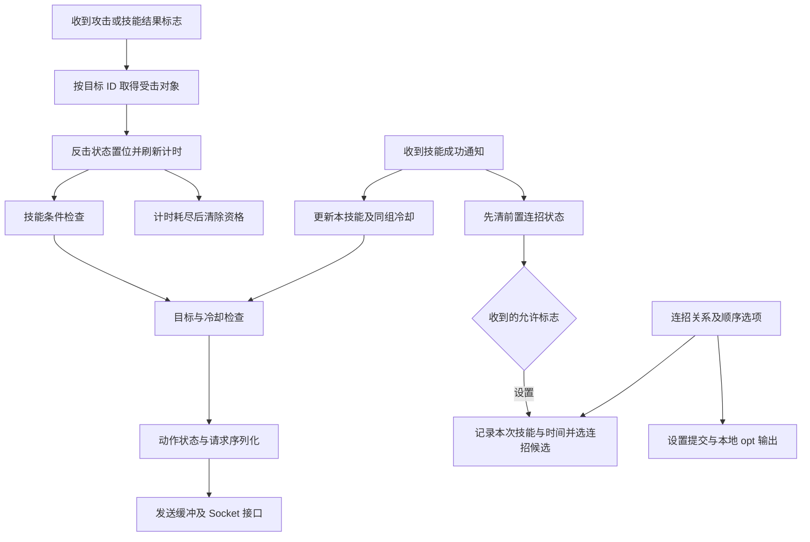

# AION 条件技能与施放机制分析

分析持续进行中。当前 Game.dll 静态证据已连接收到的攻击结果、受击玩家、反击资格倒计时、操作检查、施放请求、成功后的连招状态、共享冷却和选项保存。直接更新本记录，不再按轮次交付。计时接口下探到同批 CrySystem.dll；保护代码中的系统 API 目标、全局使用消耗与官方判定仍有明确边界。

样本 SHA-256：`834300c2a85b6427de2d4a4be2931ff2ea59fd70f48f31754f5c2181753bd786`。地址使用首选映像基址 `0x180000000`，并非游戏运行地址。新的实际 REA 响应位于 [持续分析证据目录](../evidence/continuous/)，合同、哈希、数据库身份及清理核对见 [verification.json](../evidence/continuous/verification.json)。检查通过不表示整个游戏分析完成。

## 条件技能检查读取角色当前状态

`61EE50` 先取得技能对象，复制 2008 字节技能记录。指令中复制目标从栈槽 `var_808` 开始，反击掩码在 `var_A0`，差值正好为 `+0x768`，与之前具名字段解析一致。

它把该掩码转换后，与经 `4F9810` 取得的本地对象 `+0x2EC` DWORD 相交，并写第三个参数指向的输出。转换如下：

| 条件名字 | 技能记录位 | 角色状态位 | 对应剩余计时槽 |
| --- | --- | --- | --- |
| dodge | `0x80` | `0x20` | `+0x2F0` |
| parry | `0x40` | `0x40` | `+0x2F4` |
| block | `0x20` | `0x80` | `+0x2F8` |
| resist | `0x100` | `0x2000` | `+0x2FC` |

名字与技能记录位来自原始六项名称表；状态位来自实际指令转换；计时槽来自设置和更新函数。`4BF7A0` 和 `4F9810` 经实体容器的虚表 `+0x50` 分别查询类型 1、2。原始 RTTI 将该容器确定为 Player；Player 的 `+0x50` 指向 `01A4B0`，实际指令对类型 0、1、2 都把 `RCX` 原值写到输出，没有指针调整。这确认了此 Player 路径中的对象身份，而非只因偏移相同就合并字段。

对象身份证据：[Player 构造指令](../evidence/continuous/20261012-session-b/player-constructor-instructions.normalized.json)、[组件查询实现](../evidence/continuous/20261012-session-b/player-component-query-instructions.normalized.json)、[RTTI 继承表示](../evidence/continuous/20261012-session-b/player-base-hierarchy-original-pe.json)、[虚表查询槽](../evidence/continuous/20261012-session-b/player-component-query-slots-original-pe.json)。虚表与 RTTI 的原始读取属于辅助 PE 证据，不是运行时内存。

名称表原文是小写 `block`，资源原文是 `Block`。比较槽 `6BC748` 的运行时目标和大小写行为尚未解析，实际游戏内技能154装载后的掩码也未读取；上表的名称是依据原始名称表与代码数值转换建立的语义对应，没有声称采到了运行时记录。

`61EE50` 的函数返回值表达“出现了适用条件”，第三个输出表达条件当前是否匹配。两者不能混用。它还处理目标状态、另一项本地条件、前置连锁和其他检查；后续分支可能改写输出，不能把单个掩码相交当全部条件最终结论。

证据：[检查指令](../evidence/continuous/20261012-session-a/skill-check-instructions.normalized.json)、[成功函数分析](../evidence/continuous/20261012-session-a/skill-check-dossier.normalized.json)、[对象获取](../evidence/continuous/20261012-session-a/player-object-getter-instructions.normalized.json)、[原始名称表](../evidence/round10/counter-status-tables.json)。

## 触发状态有独立的倒计时

`476770` 处理传入的事件表示。在 `477178` 检查其 `0x1E0` 位，在 `47717F` 把原始常量 `874FA8` 加载到 `XMM1`。该常量的 IEEE-754 float32 字节为 `00004040`，值为 **3.0**。随后执行与上表相同的状态位转换，并在 `4771C5` 调用 `4BC8D0`。

`4BC8D0` 把输入 float32 乘以原始常量 **1000.0**，截断为整数，OR 入对象 `+0x2EC` 的状态位，再直接写对应的剩余计时槽。Block 路径写 `+0x2F8`；在这条调用链中初始值是 **3000**。再次进入同一设置路径时覆盖剩余值，没有在这两个函数中看到新增一个“可用次数”槽。

`4BCA40` 取得时间接口某虚方法返回的 float32，同样乘 1000.0 并截断。对每种状态，如果剩余值大于这次增量就减去增量，否则将剩余值置零并清除对应状态位。Block 的到期分支是 `4BCB1E` 的 `btr ecx,7`，接着写回 `+0x2EC` 并清零 `+0x2F8`。`4B9940` 与 `061C20` 均存在实际调用该更新函数的代码点。

这已经证明客户端维护了一段触发资格的有限时间状态。整数 3000 与常量 3.0 的转换和递减已确认；后文已通过 CrySystem 的计数器/频率路径补强秒单位，支持正常路径的标称3秒窗口。不用此前未知的716/1382替代此计时链路，实际服务端窗口、运行时持续时间与使用消耗继续分别核对。

调用点有浮点参数，当前 `476770` 伪代码对 `4BC8D0` 的参数显示不完整；上述 3.0 的传参以 `XMM1` 加载指令为准。

证据：[触发处理指令](../evidence/continuous/20261012-session-a/counter-state-source-instructions.normalized.json)、[触发处理函数分析](../evidence/continuous/20261012-session-a/counter-state-source-dossier.normalized.json)、[设置指令](../evidence/continuous/20261012-session-a/state-owner-body-1804bc8d0.normalized.json)、[倒计时更新](../evidence/continuous/20261012-session-a/state-owner-body-1804bca40.normalized.json)、[原始常量](../evidence/continuous/20261012-session-a/counter-trigger-duration-constant.json)、[更新调用引用](../evidence/continuous/20261012-session-a/counter-state-update-xrefs.evidence.json)。

## 状态不匹配进入客户端禁用检查

`61F860` 取得本地对象和技能记录。在普通技能分支内，如果 `61EE50` 返回非零但输出为零，或另一个辅助检查失败，进入返回 1 的路径。其他分支还涉及技能类型、物品、目标和区域等检查。本函数的 1 是该检查链的拒绝结果，不是“可用”。

`620A20` 对适用的技能范围调用 `61F860`，非零时返回 0；通过其他检查后才返回 1。`0C0EB0`、`240B20` 等也消费 `61F860`。

证据：[客户端禁用检查](../evidence/continuous/20261012-session-a/skill-check-main-dossier.normalized.json)、[布尔包装指令](../evidence/continuous/20261012-session-a/skill-state-boolean-instructions.normalized.json)、[包装调用引用](../evidence/continuous/20261012-session-a/skill-boolean-xrefs.evidence.json)。

## 连锁概率字段有 UI 消费者

`27EA10` 读取记录 `+0x7A4/+0x7A8`，计算 `prob1 × 返回对象的一个值 + prob2`，再用结果决定绘制参数组。记录构造函数 `1200C0` 清零完整的 2008 字节区域。`53C3F0` 每条接受的 XML 记录再次构造默认记录并复制 2008 字节；只有遇到相应字段，才在 `53FDC2/53FDF2` 写 `var_15BC/var_15B8`，与记录起点 `var_1D60` 的差值分别为 `+0x7A4/+0x7A8`。解析结束的 `53C2B0` 只读另一段字段，`0E7D90` 把记录原样复制到存储区。

因此，在这条已读取的 XML 装载路径上，技能154缺失的 `chain_skill_prob1` 保持构造默认值 0，`chain_skill_prob2` 解析为10。未证明启动后不会有其他覆盖，也未用客户端绘制计算替代服务端随机判定。

技能154资源的 `counter_skill=Block`、`chain_skill_prob2=10` 与角色状态位、计时和绘制字段是不同事实。当前没有把 10 用作盾防概率乘数，也没有把 UI 绘制分支等同于官方后台随机判定。

证据：[绘制消费者](../evidence/round11/ida95-condition-state/chain-node-slot1-dossier.normalized.json)、[记录构造函数](../evidence/continuous/20261012-session-a/skill-record-default-instructions.normalized.json)、[当前 XML 解析指令](../evidence/continuous/20261012-session-a/skill-record-parser-instructions.normalized.json)。

存储证据：[解析后的只读检查](../evidence/continuous/20261012-session-b/skill-record-postprocess-final-retry-instructions.normalized.json)、[记录存储复制](../evidence/continuous/20261012-session-b/skill-record-storage-retry-instructions.normalized.json)。

## 连招绘制读取的是 SkillItem 的等级表示

继续追踪 `27E820` 后，确认其返回对象来自管理器 `D4B010` 的 `+0x830` 分组树：它按连招组枚举资源技能，调用 `542790` 读取记录 `+0x794`，选取已有对象。当前 XML 解析器将 `chain_category_level` 写入该偏移，所以这里的排序值是连招分类等级，不能直接称为角色等级或盾防数值。

`3B2370` 分配88字节并调用 `3A1940`；后者写入 SkillItem 虚表，原始 RTTI 名字为 `.?AVSkillItem@@`。`3B246E` 把第四参数的低16位经符号扩展写入 `SkillItem+0x64`，再通过 `3B1A60` 登记到 `+0x830`。登记方法使用其低16位作为内部排序键；`3B2100` 从此树取回对象。至此，生产者、登记、取回与绘制读取的对象身份已连接。

当前 `S_ADD_SKILL` 内部 ID44 在 `4288CE` 进入 `431ED0`。该处理器从每条表示的 `+2` 读取 DWORD，经 `DI→R9D` 传到上述对象创建函数。这些用途支持把 `+0x64` 解释为收到的技能等级值；业务命名属于推断，实际加载等级和服务端含义没有运行时采样。它不是沿此链路读出的角色盾防值。

还查到表示宽度的变化：普通操作 `3B2840` 取 `+0x64` 的低16位，传给 `014E40`，再写 Player `+0x14E0`。已定位的施放分支将该 WORD 传给 `3503C0`，而序列化器 `3503E2` 实际只把 `R8B` 写到缓冲 `+9`。动作函数在部分分支还会 OR `0x80` 到 `+0x14E0`，所以这个发送字节可能混有动作标志，不能把全部8位称为纯等级，更不能解释为服务端剩余使用次数。没有捕获加密后线上字节或对端接受结果。

完整扫描已解 `client_skills.xml` 的7160条记录：185条含至少一个连招概率字段，48条显式 `chain_skill_prob1` 全为0，其余记录未写该字段。结合已确认的逐条清零/默认复制路径，在没有后续覆盖的前提下，全部这些 XML 装载记录的 UI 线性计算不依赖 `SkillItem+0x64`；技能154仍为 `0×值+10=10`。这里的10是绘制分支输入，依然不等于已经证明的官方触发率10%。

另外，SkillItem 虚表 `+0x18` 对应 `3A19C0`，递减对象 `+0x6C`。管理器 `3A4320` 以 CrySystem 累计时间乘1000后计算增量，交给该虚方法。`+0x6C` 的倒计时与共享冷却 `+0x54` 的绝对截止值是不同字段；没有因相邻偏移或同一对象而合并其业务含义，也没有把这个字段作为 Player 反击资格消费的证据。其完整触发/业务用途仍待追踪。

证据：[链组取回](../evidence/continuous/20261012-chain-value/chain-value-getter-instructions.normalized.json)、[分类等级读取](../evidence/continuous/20261012-chain-value/skill-rank-comparator-instructions.normalized.json)、[SkillItem 构造](../evidence/continuous/20261012-chain-value/skill-object-constructor-instructions.normalized.json)、[创建和字段写入](../evidence/continuous/20261012-chain-value/skill-object-main-update-instructions.normalized.json)、[技能添加通知](../evidence/continuous/20261012-chain-value/skill-list-message-instructions.normalized.json)、[等级分组登记](../evidence/continuous/20261012-chain-value/skill-object-group-insert-instructions.normalized.json)、[类型与虚表](../evidence/continuous/20261012-chain-value/original-skill-item-vtable.json)、[字段宽度与机制核对](../evidence/continuous/chain-object-verification.json)、[完整概率资源清单](../evidence/continuous/20261012-chain-value/chain-probability-resource-fields.json)。

## 收到的攻击标志写到受击对象

当前具名注册表中的 `S_ATTACK` 内部 ID 为54；当前路由进入 `430D20`。这只是本地内部 ID，没有把它当网络线上的 opcode。处理器取得消息负载，在负载 `+0x0E` 读取 DWORD 状态标志，`+0x08` 读取目标 ID，再把状态表示传给攻击者组件虚表 `+0x288`，Player/AIObject 对应实现 `480890`。

`480890` 将目标 ID 存入新记录起点，把该状态表示复制到记录 `+0x28`，并把记录加入攻击者 `+0x1110/+0x1118` 的待处理序列。`473070` 随后按记录目标 ID 查实体，经 `4BF7A0` 得到受击对象；`47360B` 把该对象作为 `RCX`、攻击者作为 `RDX`、记录 `+0x28` 作为 `R8` 调用 `476770`。至此，收到的标志进入受击对象的反击资格设置链，若受击者是本地 Player，就与 `61EE50` 的检查对象一致。

`476770` 设置资格后，在 `4771CA` 执行 `and dword ptr [r14],0xFFFFFE1F`，清掉待处理记录中的 `0x1E0` 位，避免同一份记录在这条路径里重复触发。**这是事件标志消费，不是施放技能后的资格消费。** 新收到的记录仍可以再次设置并覆盖对应剩余计时。

技能成功结果另经 `4E9C00→组件虚表+0x2A0→481AD0` 形成 `+0x1128` 序列，`473650` 按记录 `+8` 的目标 ID 找到受击对象，再把记录 `+0x48` 的状态表示交给 `476770`。`481890` 先调用 `4812F0` 处理既有序列，再复制本次成功通知的其他字段；不能把这个先后关系写成“直接对新结果即时触发”。

证据：[消息名与内部 ID](../evidence/continuous/20261012-session-a/current-message-name-map.json)、[攻击结果解析](../evidence/continuous/20261012-session-a/combat-result-handler-instructions.normalized.json)、[攻击记录创建](../evidence/continuous/20261012-session-a/combat-result-action-instructions.normalized.json)、[受击对象转交](../evidence/continuous/20261012-session-a/counter-receive-a-instructions.normalized.json)、[技能结果记录](../evidence/continuous/20261012-session-b/skill-target-result-queue-instructions.normalized.json)、[技能结果消费](../evidence/continuous/20261012-session-a/counter-receive-b-instructions.normalized.json)。

## 操作检查后生成施放请求

`13DF40` 检查 `620A20`，再构造操作对象，进入 `3A57E0`。该函数的类型21分支调用 `3B2840`；后者检查目标、技能对象与冷却，随后调用 `014E40` 设置 Player 的 `+0x14A8` 动作种类、`+0x14AC` 子状态、`+0x14B0` 技能 ID 等字段。这里只陈述已追踪的技能操作路径，不声称覆盖所有 UI、宏或脚本入口。

Player 更新 `061C20` 的动作2分支进入 `046ED0`。在实际施放子状态中，它经过 `058A60` 的目标/移动检查、准备消息字段并调用 `3503C0` 序列化。随后调用 `4209E0`；这个函数在特定模式下把消息交给 `4210E0` 的录制路径，末尾返回 false。调用方随后在网络上下文启用时进入 `41FD80`。

`41FD80` 对缓冲进行状态相关 XOR 变换，尝试 `4477D0` 输出，剩余数据进入上下文待发送缓冲。`4477D0` 循环调用全局 Socket 接口虚表 `+0x10`，根据返回值推进缓冲、处理错误或剩余数据。因此，路径已经追到发送接口边界；加密后线上字节、对端接受结果和该接口的最终运行时实现没有捕获。

在已返回的操作、施放准备与发送指令中，未发现直接扣减 Block 剩余次数或清除 Player `+0x2EC` 的 `0x80` 位。这个局部事实不能推出“官方允许无限反击”。施放还受冷却、目标条件和服务端回应约束。

证据：[施放更新](../evidence/continuous/20261012-session-b/skill-casting-tick-instructions.normalized.json)、[发送前的录制分支](../evidence/continuous/20261012-session-b/skill-packet-send-instructions.normalized.json)、[消息录制](../evidence/continuous/20261012-session-b/skill-request-transport-instructions.normalized.json)、[网络缓冲处理](../evidence/continuous/20261012-session-b/skill-request-fallback-send-instructions.normalized.json)、[Socket 接口调用](../evidence/continuous/20261012-session-b/socket-output-instructions.normalized.json)。

## 成功通知决定前置连招状态

当前注册名是原文 `S_SKILL_SUCCEDED`，内部 ID43，路由进入 `431360`。它解析技能 ID、结果及标志，再调用本地对象虚表 `+0x2B8`。Player 原始虚表该槽指向 `012720`，其第一项处理是调用 `482530`。

`482530` 在 `4826A9` 先以 `EDX=0` 调用对象虚表 `+0x190`，清空前置技能；只有输入标志的 `0x20` 位设置，才在 `4826BE` 以本次技能 ID 再调用同一接口。Player 该接口是 `0570F0`：写 `+0x324` 技能 ID、通过时间函数写 `+0x328`，然后调用 `3B4680` 更新连招候选。标志来自收到的成功通知，在这里没有看到以资源数字10本地随机抽签。

`3B4680` 查询已登记关系，依据 `change_usable_skill/change_chain_skill` 选项、候选技能冷却与链条时间检查选择替代项；在适用分支写技能管理器 `+0x840`。`61EE50` 对带前置链的技能比较前置编号与记录 `+0x798`、并检查当前时间和 Player `+0x328` 的差。关系登记、UI顺序、成功标志和剩余反击资格由不同字段承担。

`431360` 的本地施法者分支还调用 `3B2500` 更新技能对象 `+0x50/+0x54` 的冷却表示。收到一次技能成功、前置连招允许与反击资格还剩多久不能计成同一种“次数”。

证据：[成功通知解析及虚调用](../evidence/continuous/20261012-session-b/skill-success-handler-instructions.normalized.json)、[Player 成功处理](../evidence/continuous/20261012-session-b/skill-state-success-local-instructions.normalized.json)、[标志分支](../evidence/continuous/20261012-session-b/skill-state-success-base-instructions.normalized.json)、[Player 完成虚表槽](../evidence/continuous/20261012-session-a/player-completion-vtable-original-pe.json)、[前置技能及时间写入](../evidence/continuous/20261012-session-b/chain-writer-body-1800570f0.normalized.json)、[连招候选选择](../evidence/continuous/20261012-session-b/chain-eligibility-helper-instructions.normalized.json)。

## 显式清除事件与窗口到期有不同入口

`488830` 创建类型21的延时事件并送入对象 `+0xF50` 队列；`4A5620` 的类型21分支把事件 `+0x58` 交给对象虚表 `+0x260`。Player 对应 `058CA0`；该函数仅在传入表示第一个 DWORD 为0时，以第二个 DWORD 的反码清除 `+0x2EC` 位。

已核对 `488830` 的11个直接调用点：普通施放更新传 `R8D=0/R9D=1`，形成事件表示种类1，处理的是施放子状态通知；其他已读入口清除或管理 `1/0xC/0x12/0x600/0x1800/0x4000` 等不同掩码。`4BC8D0` 对 `0x20E0` 内的计时资格直接进入专用计时分支。这些调用没有建立“每次反击技能施放都通过该队列清除0x80”的证据。

窗口到期清除 `0x80` 已有独立正面证据；使用时消耗仍需更广泛的对象别名、批量复位及服务端结果检查，不能以有限静态搜索证明全局不存在其他写入。

另有两个已确认的批量复位：CharacterObject 构造 `4B0F00` 对 `this+0x2C0` 开始的 `0x27C` 字节区域清零，覆盖资格位与四个计时槽；`4BB4C0` 的对象模式7分支在 `4BB5EE` 直接清零整个 `+0x2EC`，并清空 `+0x324/+0x328`。后者是已有状态与动作的批量重置，不能命名为“反击施放扣一次”。

证据：[队列事件创建](../evidence/continuous/20261012-session-a/counter-state-clearing-helper-instructions.normalized.json)、[事件分派](../evidence/continuous/20261012-session-a/combat-trigger-dispatch-instructions.normalized.json)、[Player 清除消费者](../evidence/continuous/20261012-session-a/counter-generic-clear-instructions.normalized.json)、[实际调用引用](../evidence/continuous/20261012-session-b/queued-state-clear-callers.evidence.json)。

批量复位证据：[CharacterObject 构造](../evidence/continuous/20261012-session-b/character-constructor-retry-instructions.normalized.json)、[状态复位](../evidence/continuous/20261012-session-b/actor-last-skill-reset-instructions.normalized.json)、[Player 复位包装](../evidence/continuous/20261012-session-c/player-batch-reset-body-retry-instructions.normalized.json)。

## 顺序配置与战斗状态分别维护

此前找到的 `39E770` 是登记关系递归查询，`39ECF0` 生成名为 `chainskill` 的表示。进一步查出的 `507710` 比较表示内容，`507950` 复制表示，**`507470` 验证选项值的类型和范围**。实际持久化继续下探如下。

它们与角色 `+0x2EC/+0x2F8` 的触发状态不同。更改连锁显示顺序不等于得到一次反击资格。

证据：[比较](../evidence/continuous/20261012-session-a/configuration-compare-instructions.normalized.json)、[复制](../evidence/continuous/20261012-session-a/configuration-copy-instructions.normalized.json)、[选项验证](../evidence/continuous/20261012-session-a/configuration-update-instructions.normalized.json)。

`507D60` 从 `UI_OptionList.xml` 装载选项定义。当前资源将 `chainskill` 声明为 `type=binary/setting_type=1/save_frequently=1/version=153`；两个自动替换开关默认 on。`5092B0` 遍历选项表示并生成 UTF-16 XML，按选项类型和选定组过滤。它只是序列化，不是读盘函数；工作文件名中的预备标签不作为函数语义。

`062B80` 先调用 `39ECF0` 同步链条表示，再按组0、1序列化，经系统虚表 `+0x118` 转换为带长度信息的块，交给 `359240`。后者日志原文是 `SaveClientSetting type(%d)`，构造请求缓冲并调用 `41FD80`。收到的设置由具名消息 `S_LOAD_CLIENT_SETTINGS` 相关路径最终交给 `05A910→50A200` 解析。这里证明提交与读取路径；对端持久化成功、账号同步细节没有网络实测。

本地另有 `125910→50BED0`。`125910` 按服务器表示和本地角色名形成 `%s_%s.opt`、`%s_%s_environment.opt` 或 `%s_%s_quickbar.opt`，选择保存组后调用 `50BED0`。后者以 `wb` 打开文件流，写选项版本，序列化所选组，再经 `0B8DD0` 调用系统虚表 `+0x118` 转换块，写长度和内容，关闭文件流。保护桩遮住具体 CRT 导入名，但 `wb` 参数、流对象流转、尺寸/数量调用参数及成功/失败消息共同支持这是实际本地文件输出。`.opt` 不是直接的纯 XML 文件，当前运行时目录与实际文件内容尚未采集。

保存证据：[定义装载](../evidence/continuous/20261012-session-c/options-name-registry-instructions.normalized.json)、[资源定义原文](../evidence/continuous/20261012-session-c/chain-option-resource-definitions.json)、[XML 序列化](../evidence/continuous/20261012-session-c/options-content-loader-instructions.normalized.json)、[网络提交组织](../evidence/continuous/20261012-session-c/options-transmit-instructions.normalized.json)、[设置请求发送](../evidence/continuous/20261012-session-c/options-request-send-instructions.normalized.json)、[本地文件名](../evidence/continuous/20261012-session-c/options-save-filename-instructions.normalized.json)、[文件流写入](../evidence/continuous/20261012-session-c/options-local-output-instructions.normalized.json)、[块转换](../evidence/continuous/20261012-session-c/options-compressed-blob-instructions.normalized.json)。

读取证据：[当前消息路由 case30](../evidence/continuous/20261012-session-a/message-router-instructions.normalized.json)、[设置块解码与解析调用](../evidence/continuous/20261012-session-c/options-received-input-instructions.normalized.json)。

## 冷却分组参与实际更新

`53C3F0` 解析 `delay_type/delay_time/delay_id`，分别写技能记录 `+0xD0/+0xD4/+0xE0`，并将 `(delay_id,技能ID)` 登记到 `95A6A8`。`3B2500` 先为本次技能对象写 `+0x50` 时长和 `+0x54` 截止时间，再查本次技能记录的 `+0xE0`，遍历相同组的其他已登记技能对象。

新增确认两种收到通知的边界。`S_LOAD_SKILL_COOLTIME` 内部 ID51 的路由读取每项 ushort 技能 ID 和 DWORD 时间值，将时间值乘1000后加本次 `181244AE3` 的返回值，调用 `3B27D0` 写技能对象 `+0x54`；对象尚不存在时登记到管理器 `+0x868` 的暂存结构。这是客户端装载收到冷却表示的路径，没有因此识别受保护时钟 API 或采到实际服务器时间值。

`S_RESET_SKILL_COOLING_TIME` 内部 ID73 的路由读取技能 ID 和一个 byte，再取技能记录 `+0xD4` 的 delay_time，将二者作为 `3B2500` 的时长及乘数传入。沿已确认的更新函数，byte 为0时产生零时长，非零时按该乘数更新；不能只凭名字断言每次通知必定清空所有冷却。它复用同组更新路径，并未成为 Player 反击资格清除的证据。内部 ID 仍不作为加密后网络 opcode。

通知证据：[当前路由](../evidence/continuous/20261012-chain-value/skill-list-route-instructions.normalized.json)、[收到截止值写入与暂存](../evidence/continuous/20261012-chain-value/skill-value-update-instructions.normalized.json)、[来源与表示核对](../evidence/continuous/chain-object-verification.json)。

同组其他对象的时长来源于自己的 `delay_time`。`delay_type=0` 时直接使用；非零分支将它乘另一路取得的比例、除以1000，并向零截断，再乘调用者输入倍率。`3B2840/3B4680` 都有冷却读取消费者。共享组、攻击速度相关比例及收到的主技能时长是不同输入，不把它们压成一个无条件公式。

当前 Block 技能资源可归成下列组；数据是客户端声明，物理时间单位与当前官方实际冷却未作运行核验。

| 资源技能系列 | 技能 ID | delay_id | delay_type | delay_time |
| --- | --- | --- | --- | --- |
| WA_AvengingCrash | 154/155/156/157/181 | 123 | 0 | 15000 |
| KN_AvengingBlade | 403/404/405/459 | 403 | 0 | 60000 |
| KN_AvengingBash | 507/508/509/538 | 507 | 0 | 24000 |
| KN_FrozingShield | 529/2061 | 529 | 0 | 30000 |
| Stigma_BlockKnockBack | 11469 | 123 | 0 | 12000 |
| Stigma_AvengingCrash | 11519 | 123 | 0 | 10000 |

因此，客户端并不是为每次格挡加一枚反击“充能”：已证实的设置路径刷新同一状态的计时，实际技能可用性还读取相应冷却。这也没有证明“每次格挡只能反击一次”，因为不同 Block 技能可能属于不同冷却组，而其他使用清除及服务端约束未穷尽。

证据：[原始资源字段](../evidence/continuous/20261012-session-c/block-skill-resource-fields.json)、[具名解析与组登记](../evidence/continuous/20261012-session-a/skill-record-parser-instructions.normalized.json)、[冷却及同组更新](../evidence/continuous/20261012-session-b/skill-success-flag-update-instructions.normalized.json)、[登记适配](../evidence/continuous/20261012-session-c/cooldown-group-registry-instructions.normalized.json)。

## 时间接口已经下探到 CrySystem 的计时器

同批 CrySystem.dll SHA-256 为 `8705aeef77411a28e178832f2f242128b0b018b9546f58878c9e69df8f4e9061`，同样以首选基址 `0x180000000` 描述，不能把两个模块的相同 VA 当成同一位置。

Game 的 `CreateGameInstance` 返回固定对象 `D647C0`；构造初始化将 CXGame 虚表写入该对象，第一槽对应 `044C20`。`044C20` 将调用者传入的系统对象写到 `this+0x6630`，地址算术为 `D647C0+6630=D6ADF0`。这解释了资格倒计时使用的全局系统指针，而非依据相似函数名猜测。

CrySystem 的 `CreateSystemInterface` 构造 CSystem；其构造函数在 `this+8` 构造 CTimer。原始 CSystem 虚表 `+0x138` 对应 `0212F0`，实际返回 `this+8`；CTimer `+0x28` 对应 `171E70`，返回计时器 `+0x30` 的 float32；`+0x10` 对应 `171DF0`，返回 `+0x34` 的累计值。

CTimer 更新 `18A8D0` 调用对象 `+8` 保存的计数读取函数，把相邻计数差除以对象 `+0x20` 的频率后写 `+0x30`，将累计计数除以频率写 `+0x34`。初始化 `18A7E0` 的成功分支通过保护桩取频率并选 `18B060` 读取计数；失败分支置频率1000并选 `18B080`。更新还允许固定步长、平滑及非负裁剪，因此不能把资格窗口简单等同于未经采集的墙钟持续时间。

继续查询原始诊断文本的完整起点后，找到两条共用保护桩的消费者：`0A0820` 调用 `6BD0DA`，返回0时构造 `Timer: QueryPerformanceFrequency failed with error` 异常；`0A07A0` 调用 `6C6F75`，返回0时构造相应的 QueryPerformanceCounter 异常。它们分别与 CTimer 的频率获取和 `18B060` 的计数获取使用同一个具体调用地址，输出都为64位整数。名称位于错误文本中，并非 PE 导入名；先前对名称内部地址的空引用不表示完整文本没有消费者。

API 身份由共用调用目标、输出参数形态及具名失败分支识别，而保护桩最终跳到的运行时机器地址仍未捕获。微软定义频率为每秒计数、计数器值为计数，所以正常高精度路径的 `计数差/频率` 单位是秒。该路径支持**客户端标称3秒资格窗口**，不建立官方服务端同样判定。[QueryPerformanceFrequency 文档](https://learn.microsoft.com/en-us/windows/win32/api/profileapi/nf-profileapi-queryperformancefrequency)、[QueryPerformanceCounter 文档](https://learn.microsoft.com/en-us/windows/win32/api/profileapi/nf-profileapi-queryperformancecounter)。

还发现与实际持续时间相关的数值细节：`4BCA40` 每次先计算 float32 的 `时间差×1000`，再向零截断为整数后扣减；不是直接比较一个绝对截止时间。若每次输入恰为 float32 的1/60秒、每秒只扣减60次且没有刷新/复位，则每次扣16，需要188次更新，离线模型为约3.133秒。这个示例展示截断偏差，不是实测游戏帧率或窗口长度；更新频率、平滑、固定步长、事件时间和其他复位都会影响实际值。见 [条件明确的离线数值模型](../evidence/continuous/counter-time-quantization-model.json)。

**观察**：3.0和1000.0原始常量、剩余3000、共用的具名计数器桩、频率初始化与整数递减指令。**推导**：识别的高精度计数器语义下，正常时间差采用秒，资格标称3秒，逐次整数截断可引入偏差。**仍未知**：后备计数函数指针的运行时目标、游戏实际频率/模式/调用次数及墙钟持续时间；没有运行时内存捕获或当前官方后台代码。

证据：[模块入口和导出原始字节](../evidence/continuous/20261012-cry-timer/original-clock-imports-and-exports.json)、[Game 初始化](../evidence/continuous/20261012-session-c/game-interface-slot-0-instructions.normalized.json)、[Game 虚表](../evidence/continuous/20261012-session-c/game-interface-original-vtable.json)、[CrySystem 类型与槽](../evidence/continuous/20261012-cry-timer/original-timer-system-tables.json)、[系统构造](../evidence/continuous/20261012-cry-timer/system-constructor-instructions.normalized.json)、[计时器获取](../evidence/continuous/20261012-cry-timer/system-timer-getter-instructions.normalized.json)、[每帧值获取](../evidence/continuous/20261012-cry-timer/timer-frame-time-instructions.normalized.json)、[计时更新](../evidence/continuous/20261012-cry-timer/timer-update-slot-instructions.normalized.json)、[频率初始化](../evidence/continuous/20261012-cry-timer/timer-frequency-initialization-instructions.normalized.json)。

具名消费者证据：[完整错误文本](../evidence/continuous/20261012-cry-clock-bindings/original-clock-error-messages.json)、[计数器失败分支](../evidence/continuous/20261012-cry-clock-bindings/named-counter-error-producer-instructions.normalized.json)、[频率失败分支](../evidence/continuous/20261012-cry-clock-bindings/named-frequency-error-producer-instructions.normalized.json)、[计数读取](../evidence/continuous/20261012-cry-timer/timer-high-resolution-counter-instructions.normalized.json)、[后备指针调用](../evidence/continuous/20261012-cry-clock-bindings/timer-fallback-counter-retry-instructions.normalized.json)。

## 已追踪的机制关系

这是已定位代码路径的关系图。发送成功、对端施放接受和官方概率公式均不由图中客户端路径单独证明。

## 正在继续核对的链路

新增[对象身份与状态通知取证](AION对象身份与状态通知.md)及[状态核对](../evidence/continuous/status-values-verification.json)。`581B40` 的已读构造/调用链操作 UI3DView；`0638E0` 的两个数据引用已确认属于 CHAININFO 异常展开元数据。当前 `S_HIT_POINT` 路由连接收到值、角色更新与显示通知，`S_FLIGHT_POINT` 的字段单独绑定。受保护时钟软件 CPU 实验已经定位具体原始影子数据读取和最终取址失败，尚未返回时间值；它是辅助仿真证据，不能与真实 REA 查询或原生游戏运行混算。

- 已连接收到的状态表示与本地资格、操作发送和成功连招标志；继续核对使用消耗、批量复位及间接调用。
- 时间接口的保护桩目标与运行时单位；XML 默认路径和 `chainskill` 文件/请求消费者已追到，实际运行值及落盘/对端结果尚未采集。
- 当前客户端伤害/PVP 参数执行路径与固定旧服务端模型的差异；当前官方后台代码不在这些客户端样本中。

四个原始模块的入口、导出和声明导入已重新核对。REA 进一步取得 [ScriptDLL64 静态接口与编译脚本登记](AION脚本模块接口.md)：返回对象由 RTTI 绑定为 IScriptDLLImpl，十个虚槽目标均已读取；具体 MDamage 类的四个虚槽是两个短返回函数。后续补证将 `F054B0` 绑定为共享 CMonster，连接 Game 的 NpcScriptMgr 调用者、0x28版本校验、编译脚本名字登记和 Quest 文件消费；已读客户端外部 `+40/+48/+58` 为清零返回，`+50` 为裸返回。它们不能当成已经找到官方后台的伤害公式。另有 [Aion.bin 启动与模块装载](AION启动与模块装载.md)：已连接 CrySystem 模块名、具名工厂查询、返回接口调用及 Game.dll 初始化记录，并用真实 REA 指令补证第一层4096字节变换。模块入口与接口的进展不代表所有脚本、保护导入或当前后台已经审计完毕。

## 核对与保留的失败

持续工作累计保存1099次真实 REA 分析/状态请求：921成功、178失败；开启和关闭响应另存。918个成功分析结果通过具名合同、Evidence、样本哈希和数据库身份核对；另三个 binary_session 状态请求按自己的合同核对路径、哈希及 provider，不能当成带分析 Evidence 的指令取证。失败原文保留，不当成空逻辑。

语义核对覆盖 [资格和拒绝检查](../evidence/continuous/counter-mechanism-verification.json)、[收到事件与施放链](../evidence/continuous/call-flow-verification.json)、[保存/共享冷却/计时器](../evidence/continuous/storage-time-cooldown-verification.json)、[具名计数器共用桩](../evidence/continuous/clock-binding-verification.json)、[SkillItem 来源和表示宽度](../evidence/continuous/chain-object-verification.json)、[对象与异常元数据](../evidence/continuous/state-audit-verification.json)、[HP/飞行值](../evidence/continuous/status-values-verification.json)、[脚本接口](../evidence/continuous/script-interface-verification.json)、[启动与装载](../evidence/continuous/bootstrap-verification.json)、[系统/Game 参数接力](../evidence/continuous/system-game-binding-verification.json)、[共享脚本对象](../evidence/continuous/script-descriptors-verification.json)、[Game/ScriptDLL 接口接力](../evidence/continuous/game-script-binding-verification.json)及[移速动作与攻速修改](../evidence/continuous/movement-action-speed-verification.json)。此前新增62次 REA 请求，46成功、16失败；当前移速、动作与攻速方向另新增46次，39成功、7失败，并完成17组有明确输入的原始指令软件CPU实验；已从还原的bin64归档实际分析CryEntitySystem及CryPhysics，连接选定物理对象接口与运动输入向量。数值模型、原始 PE 算术、Capstone 候选扫描与软件 CPU 实验分别记源，不纳入 REA 请求计数，也不当实际游戏测试。

十七个独立分析会话中，十三个取得正常关闭结果并确认私有目录移除。首次 CrySystem 计时会话返回 `cleanup_incomplete`，因工作进程释放无法核验而保留私有目录；另外两个会话在正常关闭回执前中断，完成的16和2个请求仍保存，私有目录也保留，检查记录不能替代关闭回执。中断后的接口绑定 Game 会话正常关闭；新移速分析会话关闭时同样返回 cleanup_incomplete，私有目录保留。原始错误、只读检查和目录状态记录在 verification.json，不能称为全部清理完成。六个已分析原始模块的前后 SHA-256 不变，没有原生运行客户端，也未向当前官方服务器发送请求；时钟软件 CPU 实验的指令执行与数据读取单独声明。全部客户端及当前官方后台并未完成完整语义审计。
